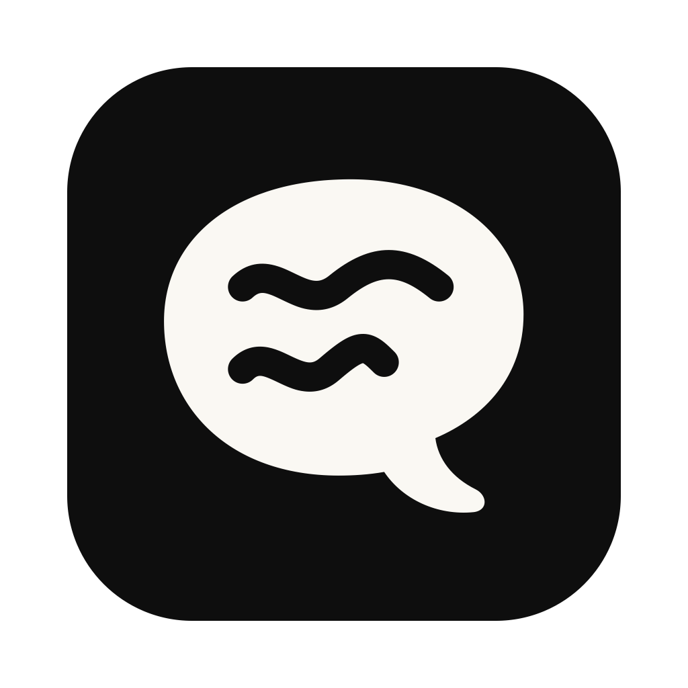
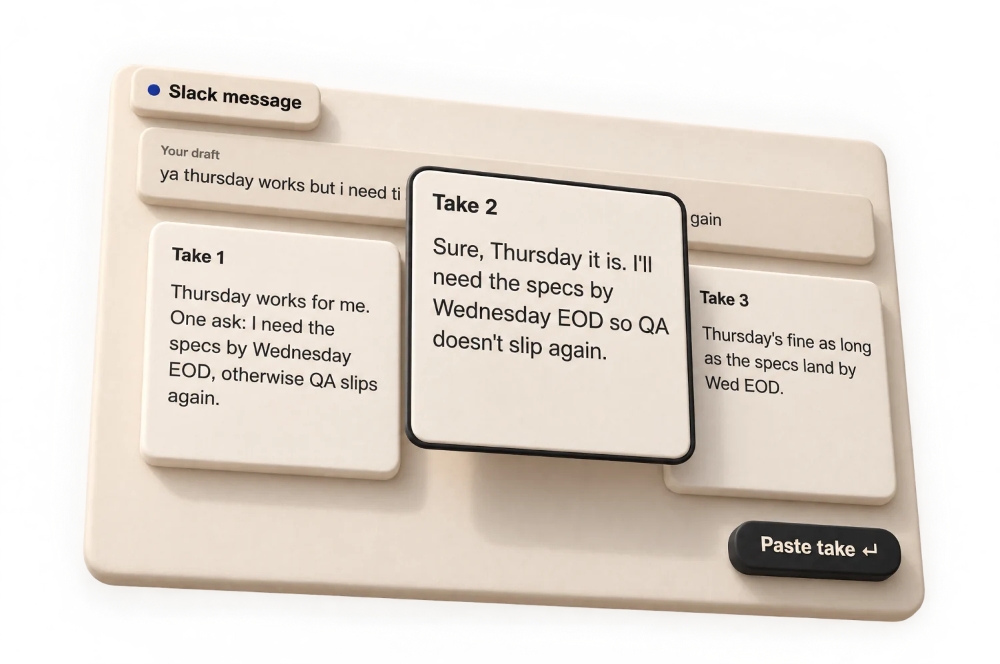
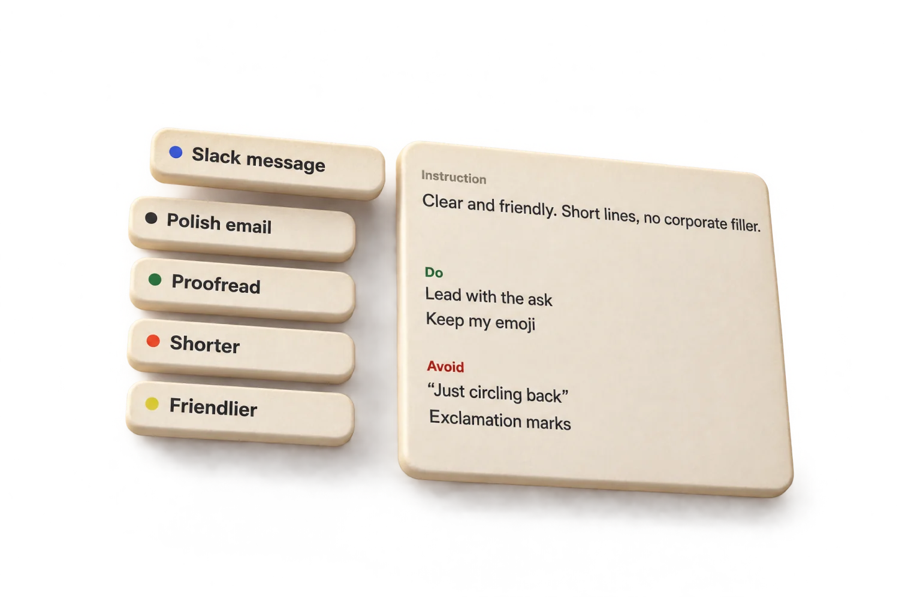
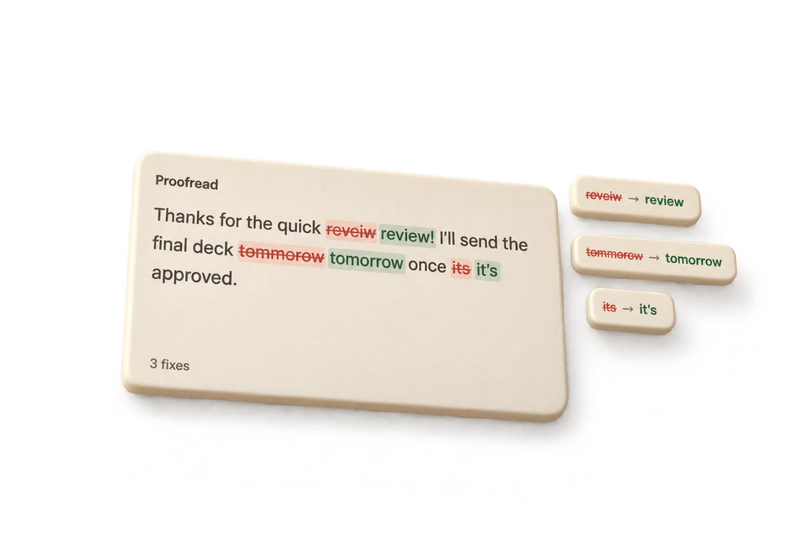
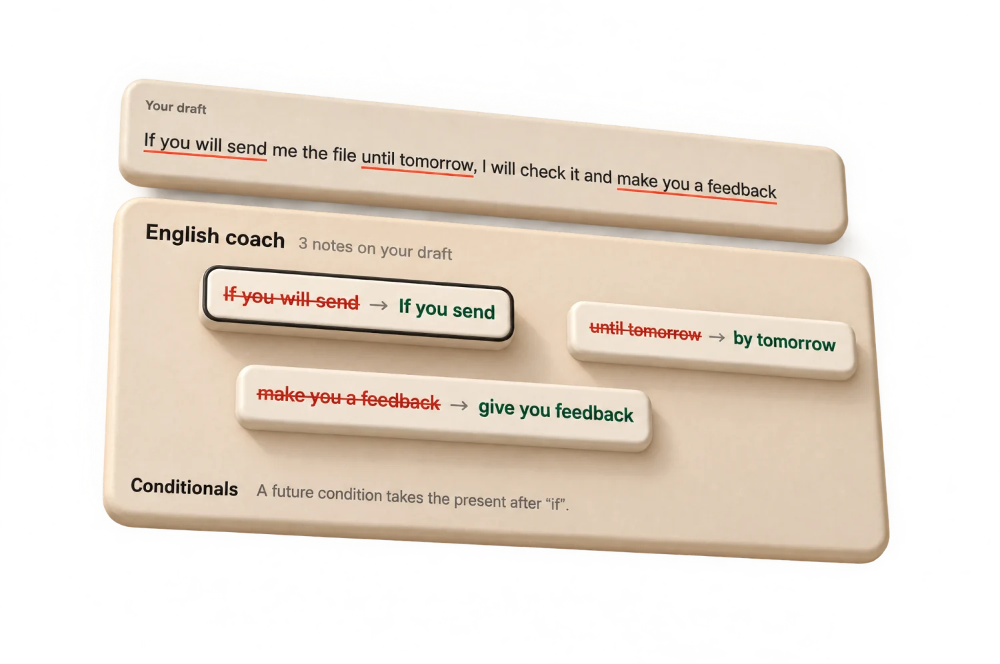
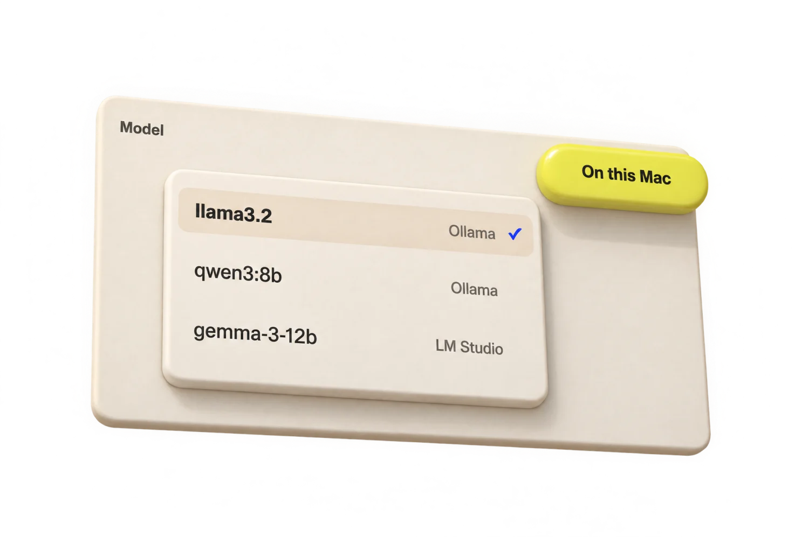
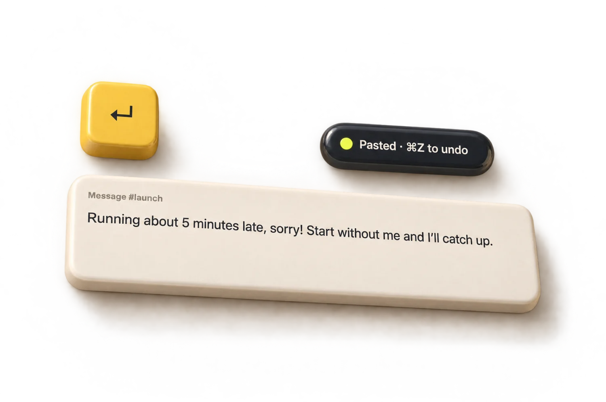
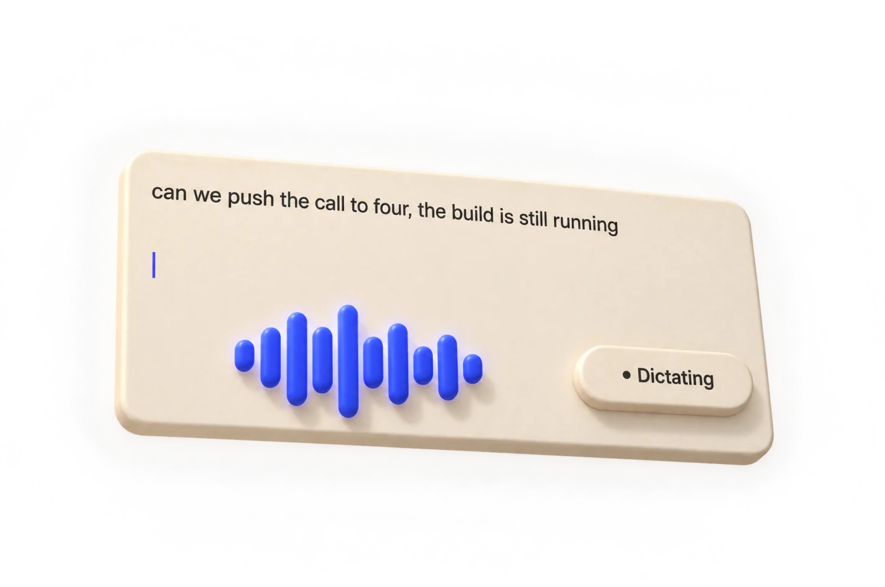

<p align="center">
  
</p>

<h1 align="center">Takes</h1>

<p align="center">
  <b>Rewrite anything you type, in any Mac app, with the Claude or ChatGPT plan you already have.</b><br>
  No server, no sign-up. Free and open source.
</p>

<p align="center">
  <a href="https://github.com/bar-amir/takes/releases/latest"></a>
  
  <a href="LICENSE"></a>
  <a href="https://github.com/sponsors/bar-amir"></a>
</p>

<p align="center">
  <a href="https://github.com/bar-amir/takes/releases/latest/download/Takes.dmg"><b>⬇ Download for Mac</b></a>
  &nbsp;·&nbsp;
  <a href="https://bar-amir.github.io/takes/">Website</a>
  &nbsp;·&nbsp;
  <a href="PRIVACY.md">Privacy</a>
</p>

```
brew install --cask bar-amir/tap/takes
```

<!-- TODO: replace with a ~10-second demo GIF of real use: a chat field → ⌃⌥Space → 3 takes stream in → paste. -->
<p align="center">
  <a href="https://bar-amir.github.io/takes/"></a>
</p>

## How it works

1. **Draft.** In any text field, in any app, press **⌃⌥Space**. Takes opens with what you've written so far.
2. **Choose.** Pick a preset (Proofread, Friendlier, Shorter, Slack message, your own…) and press ↵. A few takes stream in side by side in about 3 seconds. See what changed, refine one, or ask for more like it.
3. **Paste.** Press ↵ and the take you chose replaces your draft in the original field. Your clipboard is put back. You decide when to send.

## Features

- **Works where you type.** Slack, Mail, Messages, Notes, browsers, the Claude app. Takes reads only the focused text box, and only when you press the hotkey.
- **Presets that sound like you.** Instructions, Do and Avoid rules, up to five examples of your writing, a reply language, and the apps where each preset is picked automatically. Start from a gallery of ready-made ones.
- **Compare, don't gamble.** 1 to 5 takes at once, with a word-level "Changes" view, a refine box ("warmer", "drop the second ask") and "More like take 2".
- **Proofread.** Fixes spelling, grammar and punctuation, keeps your words, and marks every fix. When nothing needs fixing, it says so.
- **Write and paste right away.** Give a preset its own hotkey and it writes and pastes one take with no panel. ⌘Z undoes it.
- **Context and tone.** Add the message you're replying to, as reference only. Each take gets a short note on how it may come across.
- **Dictation.** Speak a draft with ⌘D. Speech is recognised on your Mac and never leaves it.
- **Any language.** Reply in any language, with a "Translate to …" preset for each one you write in.
- **Keyboard first.** Everything has a shortcut. See the [full reference](docs/usage.md).

<table>
  <tr>
    <td width="50%"></td>
    <td width="50%"></td>
  </tr>
  <tr>
    <td align="center">Presets with your rules and examples</td>
    <td align="center">Proofread, with every fix marked</td>
  </tr>
  <tr>
    <td width="50%"></td>
    <td width="50%"></td>
  </tr>
  <tr>
    <td align="center">English coach</td>
    <td align="center">A model on your Mac</td>
  </tr>
  <tr>
    <td width="50%"></td>
    <td width="50%"></td>
  </tr>
  <tr>
    <td align="center">Write and paste right away</td>
    <td align="center">Dictation</td>
  </tr>
</table>

## Install

**[Download Takes.dmg](https://github.com/bar-amir/takes/releases/latest/download/Takes.dmg)**, open it and drag Takes to Applications. Or use Homebrew:

```
brew install --cask bar-amir/tap/takes
```

Open Takes. It lives in the menu bar, and a short guided setup walks you through Accessibility access, connecting a model, the hotkey and your first presets, ending with a real take in a practice box.

- macOS 14 or later.
- Signed with a Developer ID and notarized by Apple. Updates arrive through Sparkle, and Takes asks before it starts checking.
- To uninstall, see [Using Takes › Uninstall](docs/usage.md#uninstall).

## Choose your engine

| Engine | What you need | Where your draft goes |
|---|---|---|
| **Claude Code** | [Claude Code](https://claude.com/claude-code) installed and signed in to your Claude plan | Anthropic, under your account |
| **Anthropic API key** | A key from the [Anthropic Console](https://console.anthropic.com), stored in your keychain | Anthropic, under your account |
| **Your ChatGPT plan** | A ChatGPT Plus or Pro plan; you sign in with ChatGPT in the browser, no extra cost | OpenAI, under your account |
| **Other provider** | Your own API key for OpenAI, Google Gemini, OpenRouter, Groq, Mistral or any https server that speaks the OpenAI API, stored in your keychain | That provider, under your account |
| **Local model** | [Ollama](https://ollama.com) or [LM Studio](https://lmstudio.ai) running on your Mac | Nowhere: it stays on your Mac |

Claude Code is the default. You can switch any time in Settings › Engine.

## Privacy

Takes sends your draft only to the engine you chose, directly from your Mac and under your own account: Anthropic with Claude, OpenAI with your ChatGPT plan, the provider you picked with your own key, or, with a local model, nowhere outside your Mac. Dictation audio never leaves the Mac. The developer runs no server and receives nothing from the app; the app has no analytics, crash reporting or tracking. [PRIVACY.md](PRIVACY.md) lists exactly what's read, sent and stored, how Takes follows Anthropic's and OpenAI's rules, and what the website counts.

## Costs and responsibility

Takes is free, but the model it calls isn't always:

- **Claude Code (your subscription):** each run counts toward your Claude plan's usage limits, like any other Claude Code use.
- **Anthropic API key:** you're billed by Anthropic for the tokens each run uses, usually a cent or two. Takes doesn't cap your spending; set a spend limit in the [Anthropic Console](https://console.anthropic.com).
- **Your ChatGPT plan:** no extra cost; each run counts toward your Plus or Pro plan's limits. You can cap how much Takes may use in ChatGPT › Settings › Usage.
- **OpenAI or other API key:** you're billed by that provider for the tokens each run uses. Takes doesn't cap your spending; set a limit in the provider's console.
- **Local model:** free, but it runs on your Mac's memory, CPU and battery.

What makes a run use more: more takes, a bigger model (Opus over Sonnet over Haiku), higher effort, a long draft or reply context, and write-like-me examples. Each of these is a request of its own: the tone notes after the takes (Haiku, unless you turn "Show tone" off), ⌘T, refine, "More like take N" and ⌘R.

Takes are written by an AI model. They can be wrong, miss your meaning or sound different from what you intended, and they're only as good as the preset's instructions, examples and the model you pick. Read a take before you send it. What you send, and to whom, is up to you. Takes is provided as is, without warranty (see the [License](LICENSE)).

## FAQ

<details>
<summary><b>Does it work in my app?</b></summary>

In apps whose text fields macOS can read, including Slack, Mail, Messages, Notes, browsers and the Claude desktop app. Where an app hides its field, Takes copies the text with ⌘A ⌘C instead and puts your clipboard back. If an app doesn't work, please [open an issue](https://github.com/bar-amir/takes/issues/new/choose) with the app's name.
</details>

<details>
<summary><b>Why does it need Accessibility access?</b></summary>

To read the text box you're typing in and to paste the take back. It reads only that box, only when you press the hotkey, and never the rest of the screen.
</details>

<details>
<summary><b>⌃⌥Space opens something else.</b></summary>

macOS can use ⌃⌥Space for "Show Finder search window" or for switching input sources. Setup flags this and lets you pick another hotkey (Settings › Engine).
</details>

<details>
<summary><b>The hotkey works, but nothing is prefilled or pasted.</b></summary>

Remove Takes from System Settings › Privacy & Security › Accessibility and add it again. This mostly happens after building it yourself.
</details>

<details>
<summary><b>How fast is it?</b></summary>

With Sonnet 5.5 at low effort, the first words of 3 takes appear in about 1.3 seconds and all of them are done in about 3. [Measurements](docs/development.md#performance).
</details>

<details>
<summary><b>Is it made by Anthropic or OpenAI?</b></summary>

No. Takes is an independent app. It runs the unmodified Claude Code you signed in to, or calls Anthropic's, OpenAI's or another provider's API with your own account or key. It never sees your Claude credentials; the ChatGPT sign-in happens in your browser on OpenAI's pages. [PRIVACY.md](PRIVACY.md) spells out how it follows each company's rules.
</details>

## Contributing

Takes is a small Swift package with no Xcode project. To build and run it:

```
./build.sh
open build/Takes.app
```

- [docs/development.md](docs/development.md) covers the code layout, how Takes reads text fields and calls the model, screenshots (`Takes --snapshot <folder>`) and speed tests.
- Issues labelled [good first issue](https://github.com/bar-amir/takes/labels/good%20first%20issue) and [help wanted](https://github.com/bar-amir/takes/labels/help%20wanted) are a good place to start. Reports of apps where reading or pasting fails are very welcome.
- Read [CONTRIBUTING.md](CONTRIBUTING.md) and sign the [Contributor License Agreement](CLA.md) before your first pull request.
- Maintainers: [docs/releasing.md](docs/releasing.md).

## Support Takes

Takes is free, has no ads or paid tier, and is built in spare time. If it saves you time, you can support it on [GitHub Sponsors](https://github.com/sponsors/bar-amir), also reachable from the menu-bar icon › Support Takes…. Starring the repo, reporting bugs and telling a friend help too.

## License

The code is released under the [MIT License](LICENSE). The "Takes" name and icon aren't covered by the license; please don't use them for your own fork or product.

Takes isn't made, endorsed or supported by Anthropic, OpenAI or any other provider. It runs Claude Code or calls a provider's API with your own account.
