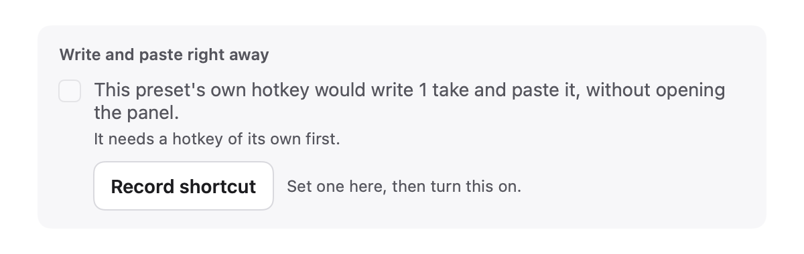
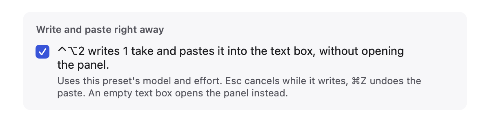
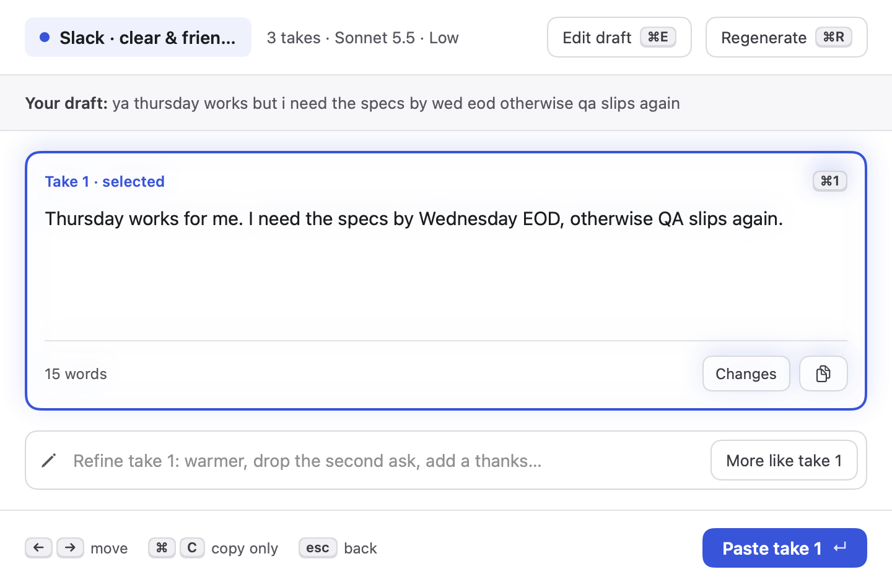
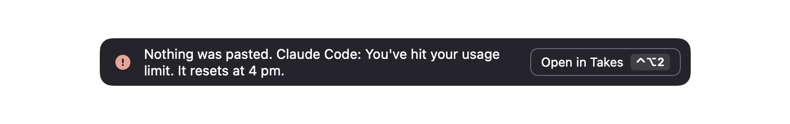

# 1 · instant-mode: write and paste right away

## What changed and why

For presets you use without thinking (proofread, shorter), opening the panel and choosing a take is a step too many. A preset can now be set to **write and paste right away**: its own hotkey reads the text box, writes 1 take with the preset's settings and pastes it in place. No panel. A small note near the text box shows that it's writing, and afterwards what happened, with a way back: ⌘Z undoes the paste, and "Open in Takes" opens the panel with that take, to refine it or write more.

It's off for every preset by default, and only works on a preset that has its own hotkey.

## The flow

1. **Turn it on.** Settings › Presets › (preset) › last section, "Write and paste right away". If the preset has no hotkey yet, the checkbox is dimmed, the text says it needs one, and a "Record shortcut" button sets it right there.

   
   
   Dark: [needs hotkey](img/instant-mode/7-instant-editor-needs-hotkey-dark.png), [on](img/instant-mode/7-instant-editor-on-dark.png)

2. **Press the preset's hotkey in a text box.** Takes reads the selection, else the field text (the existing "Start with" rule; "An empty draft" reads the field anyway, since instant mode has nothing else to write from). A toast near the caret says it's writing. The text box keeps the keyboard; Esc is held globally only while writing, and cancels. Nothing is pasted after a cancel, even if the take arrives a moment later.

   
   

3. **Pasted.** The take replaces the field text (or only the selection, if the draft was a selection), through `Paster` and its "only paste once the original app is back in front" rule. The toast offers ⌘Z undo and "Open in Takes"; pressing the preset's hotkey again while the toast is up does the same as clicking it.

   

4. **Open in Takes.** The panel opens on the takes screen with that take and the original draft. Refine it, "More like take 1", or ⌘R for the preset's usual number of takes; pasting one replaces the field again.

   

5. **When it fails, nothing is typed.**
   - Engine error (limits, no key, Claude Code missing): the engine's own message, and "Open in Takes" opens the panel on the draft so it isn't lost.
   - You switched to another app while it wrote: "You left Slack, so nothing was pasted." "Open in Takes" shows the take.
   - The app couldn't be brought back to the front: the take is left on the clipboard, "press ⌘V".
   - Empty text box, or no text box: the normal panel opens instead.
   - Pressing ⌃⌥Space (the summon hotkey) while it writes cancels the run and opens the panel.

   
   

All toasts are dark in both modes (like the existing paste toast); dark-mode renders of each are next to the light ones in `img/instant-mode/`.

## New settings

| Setting | Where | Default |
|---|---|---|
| Write and paste right away (`Preset.instantMode`, read through `Preset.writesInstantly`) | Preset editor, last section | Off |

`instantMode` is an optional `Bool` at the end of `Preset`: `Preset` uses synthesized decoding, and an optional is decoded with `decodeIfPresent`, so presets saved or exported before this load unchanged, without adding a custom `init(from:)` that `tone-check` could also be adding. Off is stored as absent.

## Shortcuts

- **Esc** while writing: cancel. Registered as a global hotkey only for the seconds it writes (`HotKeyCenter.registerTransient`), then released.
- **The preset's own hotkey, again**, while the result toast is up (6 s after a paste, 10 s after a failure): open in Takes.
- No new shortcuts in the panel.

## Privacy

Same reads and sends as the panel: the focused text box, and the draft to the chosen engine. One difference: with "Start with: an empty draft", an instant preset still reads the text box. Added a short "Write and paste right away" section under "AI output" in `PRIVACY.md`, which also notes the take is pasted before you see it. History and the run log record instant runs like panel runs (`kind: "instant"` in `runs.jsonl`, no text).

## Shared files touched (small, local)

- `Store.swift`: one optional field at the end of `Preset`.
- `Toast.swift`: `show` now calls a new `present(_:near:hideAfter:)` that any toast view can use (`hideAfter: nil` stays up). Toast windows are dark-appearance so a spinner draws for dark.
- `HotKey.swift`: `registerTransient` / `unregisterTransient`, kept apart from `replaceAll`.
- `PanelController.swift`: `summon(focus:presetID:configure:)`, so instant mode can hand over an already-read field.
- `AppDelegate.swift`: `instant.handle(presetID:)` before `panel.summon` in `summonPanel`. Setup checks still run first.
- `PresetsTab.swift`: one line, `InstantModeSection(preset: $preset)` after Run defaults.
- `Snapshot.swift`: one line calling `instantMode(to:)`.

New files: `InstantMode.swift` (decision logic, `InstantRun`, `InstantModeController`), `InstantModeViews.swift` (toast and editor section), `Snapshot+InstantMode.swift`.

## Research

- **Affordance KB.** `kb/ai-ux/agentic-ux.md`: "always interruptible" (Esc and Cancel while writing), specific status text ("Writing with Proofread only…", not "Working…"), honest outcomes (every toast says whether anything was pasted), undo and a way to take over (Open in Takes). `kb/ai-ux/ai-errors-and-uncertainty.md`: preserve input (a failed run's draft opens in the panel), plain-language failure with a next step, engine messages passed through as is. `kb/ai-ux/setting-expectations.md`: the editor copy says exactly what the hotkey will do. `kb/macos/mac-design-principles.md`: undo is the app's own ⌘Z, not a private mechanism.
- **Mobbin.** [Base44](https://mobbin.com/screens/5f0b0d41-c636-4517-a45c-d04914dc8b64): a small dark toast that names the key for the next step, which shaped putting the hotkey in the "Open in Takes" button. [Wix](https://mobbin.com/screens/1eac9fba-b503-41a8-8b0d-a175040f4713): a quiet progress note that says what it's doing. [Calendly](https://mobbin.com/screens/2b34b581-dd2a-4189-a4d8-6c47a4dce7a5): "There has been an error", the vague failure to avoid. [Square](https://mobbin.com/screens/4b0e8cdc-3203-4446-ad26-3931a11beca8): Regenerate/Insert next to generated text, the pattern "Open in Takes" leads back to.

## Self-audit

- Light and dark: editor section and panel follow the appearance; toasts are dark on purpose in both. Checked every PNG.
- VoiceOver: checkbox label, Cancel and "Open in Takes" have labels (the latter mentions the hotkey); each toast state is announced (`announcementRequested`).
- Reduce Motion: the writing spinner becomes a static ellipsis.
- Keyboard first: Esc cancels, ⌘Z undoes, the preset hotkey opens in Takes; every action is also clickable.
- Copy: sentence case, no exclamation marks, each failure says that nothing was pasted and what to do.
- Focus: the toast never takes focus; the text box keeps the keyboard throughout.
- Calm default: off everywhere; needs a deliberate hotkey + checkbox.

## Tests

`Tests/TakesTests/InstantModeTests.swift` (17 tests): empty / whitespace draft → panel; unreadable field → panel; field text replaces all, selection replaces only the selection; "empty draft" prefill still reads the field; the request is 1 take with the preset's model and effort; success pastes the trimmed first take; engine error, empty take, cancel (including cancel during a failing run), and leaving the app paste nothing; an app that won't come back reports the take on the clipboard; failure messages; old presets without the key decode with it off; round trip and "off is absent"; built-in presets are off. `swift test`: 64 tests pass. `./build.sh`: no warnings.

## Known limits

- When the draft was a **selection**, choosing another take from "Open in Takes" pastes at the cursor rather than over the first take (the selection is gone after the paste). Field-text drafts replace the whole field as expected. Press ⌘Z first in that case.
- Cancelling doesn't stop the Claude Code process or API request (the panel's own cancel doesn't either); its result is just dropped.

## Live check for the orchestrator

Use a test text box (TextEdit, Notes, Slack's composer):

1. Give "Shorter" a hotkey (say ⌃⌥2) and tick "Write and paste right away".
2. Type a sentence, press ⌃⌥2. Expect: writing toast near the caret, then the shorter take replaces the text, "Pasted · your clipboard is back". Check the clipboard was restored and ⌘Z restores the original.
3. Press ⌃⌥2 again within 6 s: the panel opens on the takes screen with that take. Pick ⌘R, paste another: it replaces the field.
4. Select one word in a longer text, press ⌃⌥2: only the selection is replaced.
5. Press ⌃⌥2, then Esc at once: "Cancelled. Nothing was pasted.", field unchanged. Esc works normally in the app afterwards.
6. Press ⌃⌥2, then switch to another app before it finishes: "You left …, so nothing was pasted."
7. Empty text box, ⌃⌥2: the normal panel opens.
8. Press ⌃⌥2 then ⌃⌥Space while writing: the panel opens, nothing is pasted later.
9. Turn on VoiceOver: the toast states are announced.
