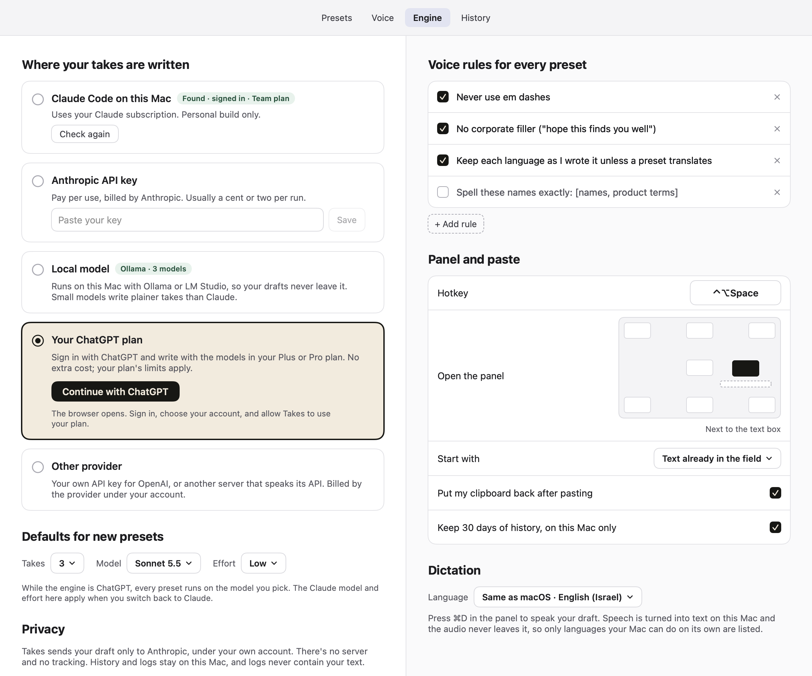
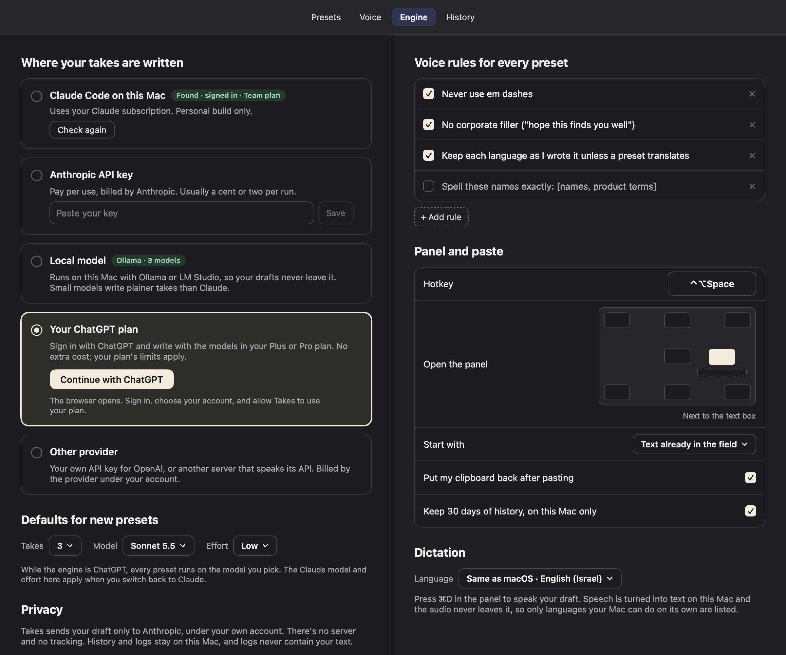
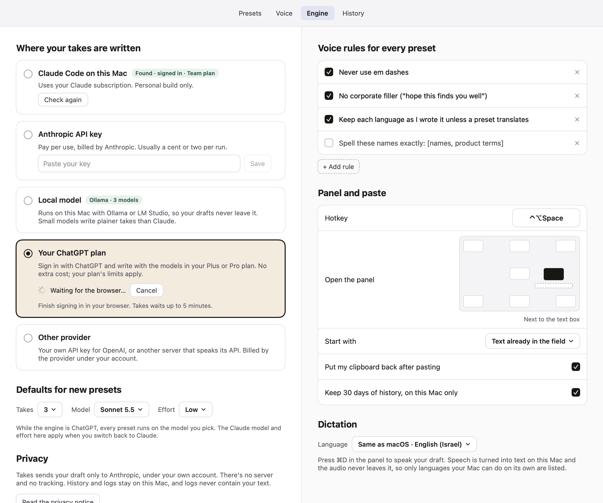
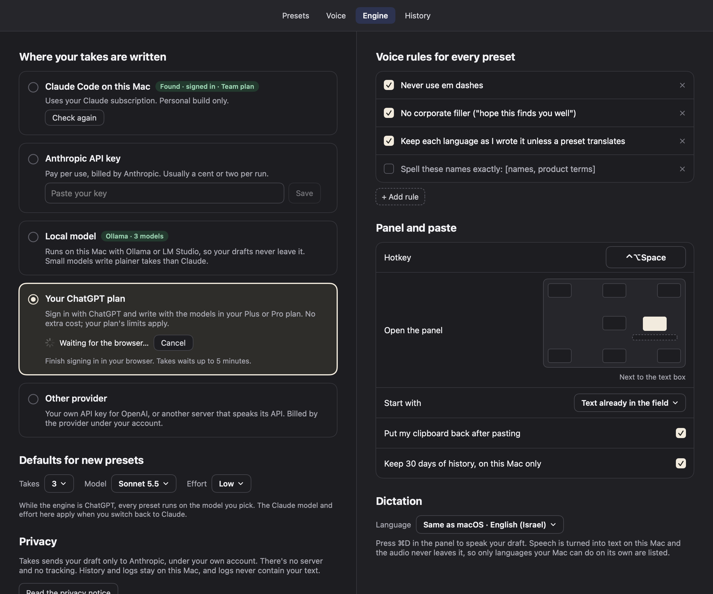
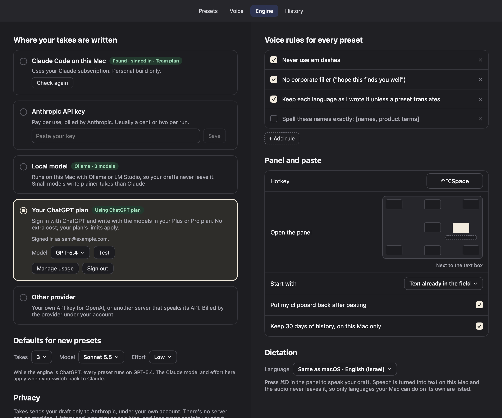
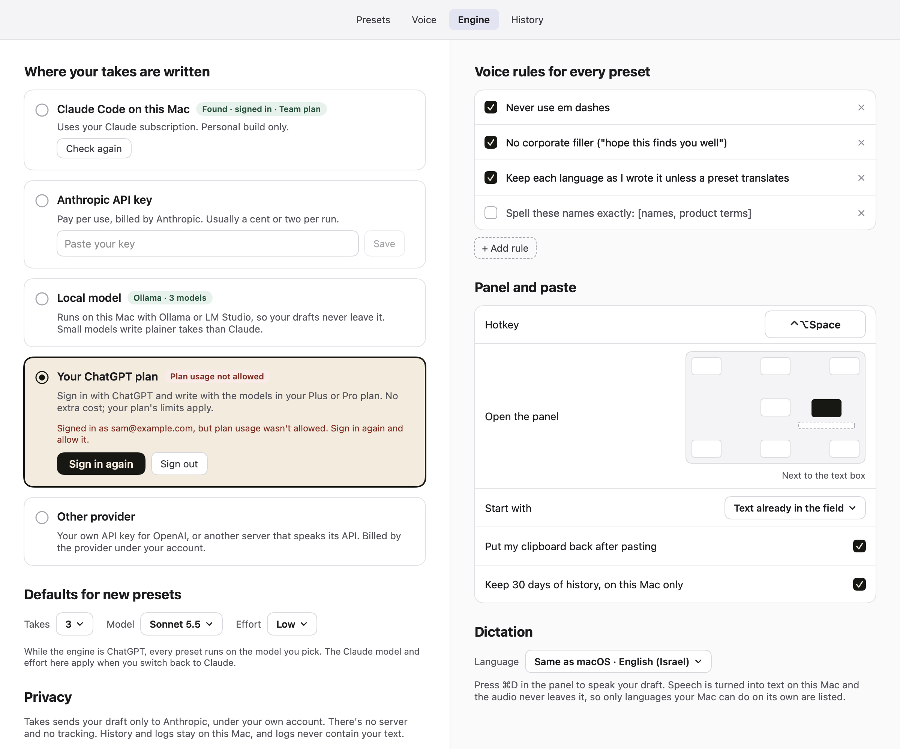
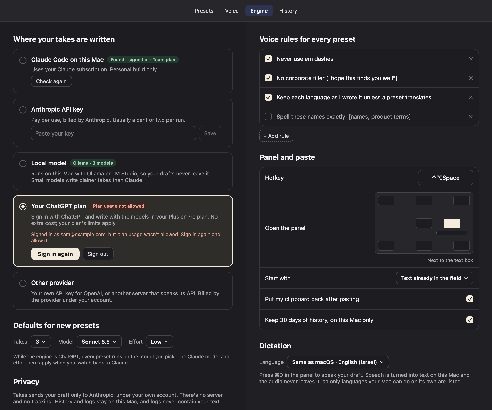
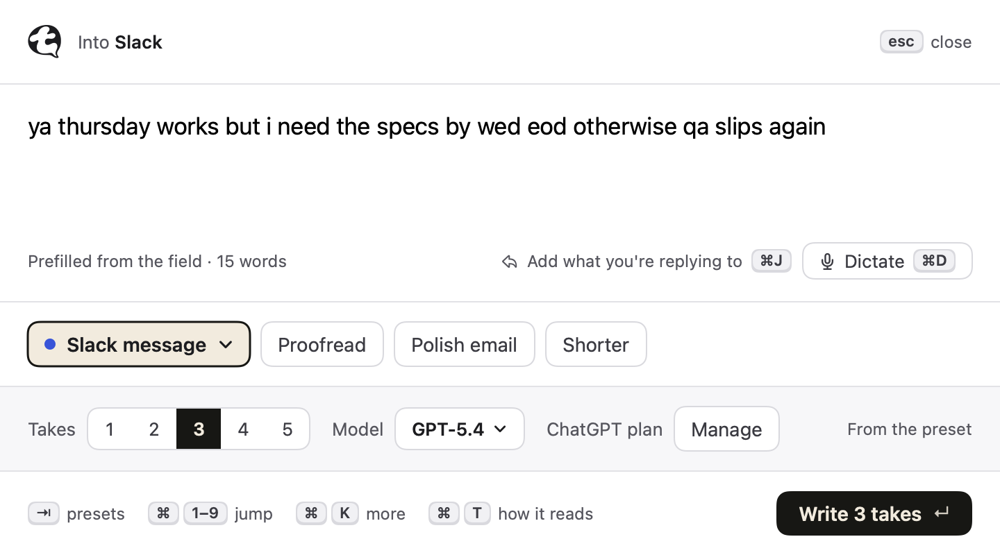
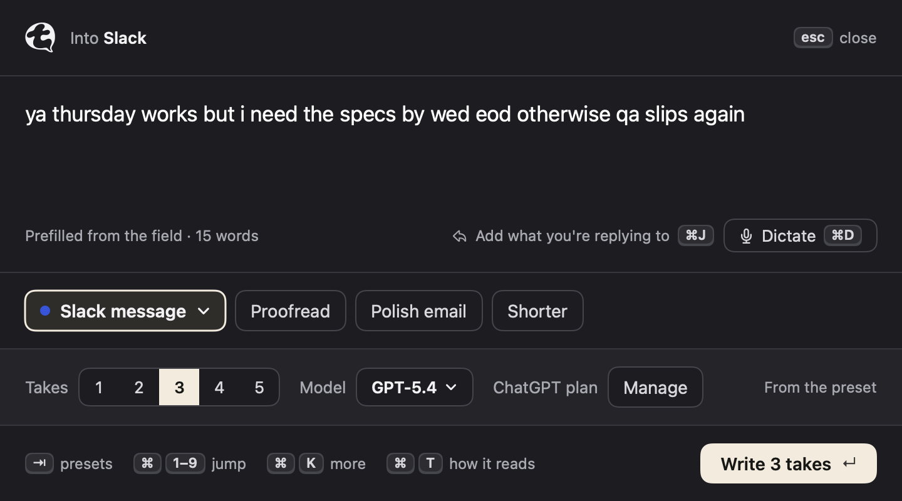

# 10 · chatgpt-signin: write takes with your ChatGPT plan

## What changed and why

People who pay for ChatGPT Plus or Pro can now pick **Your ChatGPT plan** in Settings › Engine (or in onboarding), sign
in through the browser with **Continue with ChatGPT**, and Takes writes with the models in their plan at no extra cost.
It uses OpenAI's "Sign in with ChatGPT" program for open-source and local apps: no application or approval from OpenAI,
requests only from this Mac, for this user, for Takes. Tokens live in the login keychain. Takes never sees a ChatGPT
password or cookie.

## The flow

1. **Settings › Engine › Your ChatGPT plan, signed out.** The card says "Sign in with ChatGPT and write with the models
   in your Plus or Pro plan. No extra cost; your plan's limits apply." When it's selected, it shows **Continue with
   ChatGPT** (house `PrimaryButtonStyle`, text only, no OpenAI logo or colours) and "The browser opens. Sign in, choose
   your account, and allow Takes to use your plan."
    
2. **Waiting for the browser.** Takes starts a one-shot listener on `127.0.0.1:1455` (or any free port when 1455 is
   taken), then opens the default browser at OpenAI's authorize page. The card shows a spinner, "Waiting for the
   browser…", **Cancel** (Esc) and "Finish signing in in your browser. Takes waits up to 5 minutes." After 5 minutes it
   says "The browser sign-in didn't finish within 5 minutes. Try again." with **Try again**.
    
3. **The browser tab** lands on a tiny page: "Signed in. You can close this tab and go back to Takes." (or "Sign-in
   didn't finish. Go back to Takes to try again." when the callback is refused). No script, light and dark.
4. **Signed in.** Badge "Using ChatGPT plan", "Signed in as sam@example.com.", a **Model** menu with the plan's models by
   display name (the first one is picked automatically), **Test** ("Works. Answered in 0.9 s." or the error),
   **Manage usage** (opens https://chatgpt.com/settings/usage) and **Sign out**.
    
5. **Signed in without plan usage** (the user unticked the permission on OpenAI's consent page): badge "Plan usage not
   allowed", "Signed in as …, but plan usage wasn't allowed. Sign in again and allow it.", **Sign in again**, **Sign out**.
   No request is ever sent in this state.
    
6. **The panel** works like the other one-model engines: one model for every preset, the Model menu lists the plan's
   models by display name ("GPT-5.4"), Effort hidden, and the run label says "3 takes · GPT-5.4 with your ChatGPT plan".
    
7. **Onboarding** (engine step, "Your ChatGPT plan" option): one note under the option per state, "The browser will
   open. Sign in, choose your account, and allow Takes to use your plan." → "Waiting for the browser…" → "Signed in as …".
   The step's existing primary button ("Continue with ChatGPT") starts it; the step turns ready through
   `SetupMonitor.chatGPTEngineStatus()`.
8. **Errors in the panel**, in plain words:
   - weekly allowance used up: "You've used this week's ChatGPT allowance for Takes. Manage it in ChatGPT › Settings ›
     Usage, or pick another engine."
   - plan usage unavailable: "Your ChatGPT plan can't be used in Takes right now. Check ChatGPT › Settings › Usage."
   - stream stopped early with nothing usable: "ChatGPT stopped early. Try again." (with at least one take, the takes
     are shown)
   - token refused after one refresh, or a dead refresh token: "Sign in to ChatGPT again in Settings › Engine."
   - account not eligible, model not in the plan, busy (429), service unavailable (503), region refusals (403, with
     OpenAI's detail and request ID), no network, timeout: one sentence each (`ChatGPTEngine.message`).

Setup status: ready "ChatGPT · GPT-5.4"; problems "Not signed in to ChatGPT", "Plan usage not allowed", "Pick a model".

## How it works

**OAuth** (`ChatGPTAuth.swift`):
- `ext_agent_host_id`: a `urn:uuid:` UUIDv4 made once and kept in `~/Library/Application Support/Takes/chatgpt-host.json`
  (survives sign-out; contains nothing about the user).
- Authorize (`https://auth.openai.com/api/accounts/authorize`): first time `client_id=dynamic_agent_client` +
  `agent_name_hint=Takes`; later the issued `oaiapp_…` client ID with `id_token_hint`/`login_hint` when a previous
  sign-in is still saved. Always `ext_agent_host_id`, `response_type=code`, fresh `state` and `nonce`, PKCE S256,
  the six scopes, `resource=https://api.openai.com/v1`, `redirect_uri=http://127.0.0.1:<port>/auth/callback`. Every
  query value is fully percent-encoded.
- Callback: `state` checked first (a forged `error=access_denied` is still a state mismatch); `access_denied` stops
  without exchanging; a first registration must bring an issued `client_id` (`dynamic_agent_client` is never saved);
  a later sign-in with a different `client_id` is refused. The issued client ID is saved **before** the code exchange,
  so a failed exchange doesn't register Takes twice.
- Exchange: form-encoded `authorization_code` grant to `/api/accounts/oauth/token` with `client_id`, `code`,
  `code_verifier`, the same `redirect_uri` and `resource`; no client secret.
- **ID token checks:** issuer `https://auth.openai.com`, `aud` contains the issued client ID, `exp` (2 min skew),
  `nonce`, and the **RS256 signature** against the key with the token's `kid` from the `jwks_uri` named in
  `https://auth.openai.com/.well-known/openid-configuration` (discovery's `issuer` must match). If discovery or the
  JWKS can't be fetched, the claim checks still apply and the signature isn't checked: the token came straight from the
  token endpoint over TLS (OIDC Core 3.1.3.7). A JWKS that loads but doesn't verify the token fails the sign-in.
- One account: the registration remembers the `sub` that made it. Signing in with a different account on the same
  registration is refused with "That's a different ChatGPT account from the one Takes was set up with. Try again to
  connect this one." and the registration is dropped, so the next try registers fresh.
- Storage: keychain service `com.baramir.takes`, account `chatgpt-credentials` (one JSON item: client ID, access token,
  expiry, granted scopes, refresh token, ID token, `sub`, email, name, so a refresh replaces them all at once) and
  `chatgpt-registration` (issued client ID + `sub`, kept after sign-out). `kSecAttrAccessibleAfterFirstUnlockThisDeviceOnly`.
  Own small helper (`ChatGPTKeychain`); `APIEngine.swift`'s `Keychain` is untouched.
- Refresh: `refresh_token` grant with `client_id`, `refresh_token`, `resource`, no `scope`; 60 s before expiry and once
  after a 401. Serialized in an actor (two callers, one refresh). Access token, expiry, scopes and the rotated refresh
  token are replaced together; fields the server leaves out keep their values. `invalid_grant` and the other terminal
  codes from errors-and-recovery clear the tokens (not the registration) and the card goes to signed out; network
  errors never clear anything.
- Sign out: tokens cleared on this Mac at once, then the refresh token is revoked at the discovery document's
  `revocation_endpoint` (`/api/accounts/oauth/revoke`, up to 3 tries on 5xx/network). If OpenAI doesn't confirm, the card
  says "Signed out on this Mac, but OpenAI didn't confirm it. You can also remove Takes in ChatGPT › Settings."
- Scope gate: no inference and no model list unless the granted scopes include `chatgpt.tokens.use.direct`.

**Engine** (`ChatGPTEngine.swift`): `POST https://api.openai.com/v1/responses` with `Authorization: Bearer` and exactly
`{model, instructions, input: [{role: "user", content}], store: false, stream: true}`. Text from
`response.output_text.delta`, split with `TakeSplitter` on each update; success only on `response.completed`;
`response.failed`, `error` events and plain JSON error bodies are mapped by code; `response.incomplete` keeps what
streamed if it splits into at least one take; a stream that ends without either is an error. The prompt is the same as
for Claude (no `LocalPrompt` rules); takes come back split on `===`. Models: `GET /v1/models` with the bearer token,
entries with `visibility == "list"`, server order, `slug` sent and `display_name` shown. The base URL is overridable for
tests (default `https://api.openai.com/v1`).

## Where the docs and the plan differ (the docs won)

- Reauthorization sends `id_token_hint` and `login_hint` and omits `agent_name_hint` (sign-in and profiles-and-sessions
  pages); the plan didn't mention the hints.
- The refresh grant carries `client_id` and `resource` and omits `scope` (profiles-and-sessions).
- Sign-out revokes the refresh token at the revocation endpoint (profiles-and-sessions); not in the plan.
- The issued client ID is saved before the code exchange (cookbook and sign-in page).
- The model list is under `models`, not `data` (models-and-inference). Both are accepted.
- The docs' example stores credentials in a 0600 file; Takes uses the keychain as the brief asks (stronger).
- `subscription_sharing_usage_unavailable`: the docs say retry later with bounded backoff. Takes doesn't retry on its
  own (each run is one user action); it shows the brief's message and the user presses the hotkey again.
- UI/UX guidelines (https://developers.openai.com/siwc/ui-ux-guidelines) also ask for: "Using ChatGPT plan" with a
  "Manage usage" link **near the composer or model selector**, "Manage usage" as the primary action on a usage-limit
  error ("Usage limit reached" / "Review your plan or this app's limit in ChatGPT settings."), and a one-time "You're
  using your ChatGPT plan" welcome. The card has the badge and link; the panel parts live in `PanelViews.swift`, which
  this session doesn't own. **Follow-up for the orchestrator** (see below). Their examples show the ChatGPT logo in the
  button; the plan's legal section says no logos without permission, so the button is text only. Worth a decision.
- The plan's scope-denied copy was "Try again and tick the permission"; the brief's (used) is "Sign in again and allow it."

## New settings and defaults

Nothing new in `AppSettings` beyond the scaffold's `chatGPTModel` (`""`, auto-picked from the first listed model).
New files outside the settings: `chatgpt-host.json` in Application Support, two keychain items. No new shortcuts
(Esc cancels waiting for the browser on the card, inside Settings only).

## Privacy impact

What's sent to OpenAI: the draft, the preset instruction and anything else the prompt builder puts in (reply context,
tone requests), with `store: false`, only after the user presses the hotkey. The model list is fetched when the Engine
tab shows the card, when the panel opens with this engine, and once by setup status if no model is picked. Sign-in
traffic: the browser talks to auth.openai.com; Takes talks to the token, discovery, JWKS and revocation endpoints.
Nothing goes to the developer. Tokens in the login keychain, never logged (`RunLog` isn't touched; errors include
OpenAI's request ID, never a token). The `PRIVACY.md`/README/Setup/onboarding-privacy wording is owned by the
`wording-privacy` session; the Settings › Engine **Privacy** paragraph still says "only to Anthropic" for this engine
(it's in `EngineTab.swift`, not mine), see the snapshot.

## Shared-file edits

- `LocalEngine.swift`: one line at the top of `LocalModelList.label` that returns the ChatGPT display name for a known
  slug (`ChatGPTModelNames`), so the panel's Model menu, run label and `Models.displayLabel` show "GPT-5.4".

Everything else is in my files: `ChatGPTEngine.swift` (stubs replaced, same type names), `ChatGPTAuth.swift`,
`ChatGPTEngineViews.swift` (the card and onboarding detail moved here from the stub file), `Snapshot+ChatGPT.swift`,
`Tests/TakesTests/ChatGPTTests.swift`, `Tests/TakesTests/ChatGPTLiveTests.swift`.

## Tests

`ChatGPTTests.swift`, 37 tests: PKCE (RFC 7636 appendix B vector), authorize URL first-time vs returning (and
encoding), callback parsing (state mismatch, forged denial, missing/mismatched/placeholder client ID), host ID made once,
token decoding, credentials "replace together" and keep-missing-fields, ID-token claim checks (nonce, aud, iss, exp,
malformed), RS256 against a JWKS (good, tampered, unsigned, unknown `kid`), OpenAI's real JWK loads, scope gating, request
body is exactly the five fields with `instructions`, stream event parsing incl. both usage codes, error wording, model list
filtering and order, display names reaching panel labels, settings decoding, and against mock servers on 127.0.0.1:
streaming to `response.completed`, usage limit mid-stream, 503 usage-unavailable, incomplete with and without text, a
stream without completion, 401 → refresh → retry (form fields checked, tokens replaced), proactive refresh with one
refresh for two callers, dead refresh token signs out but keeps the registration, models + Test, the whole browser sign-in
with a fake browser hitting the loopback callback, a forged callback refused, callback timeout, other paths get 404.
`ChatGPTLiveTests` (skipped unless `TAKES_LIVE_CHATGPT=1`).

`swift build` warning-free; `swift test`: 280+ tests, 0 failures.

## Live check

**Done after the merge, 2 November 2026 (orchestrator, with the user at the Mac):** on the merged build, Settings › Engine ›
Your ChatGPT plan › Continue with ChatGPT registered Takes, finished the sign-in in the browser, and the card showed
"Using ChatGPT plan" with the model list; `gpt-6.1-sol` was auto-picked. **Test** passed. From a text field, 3 takes
streamed through the panel: `runs.jsonl` logged `engine: chatGPT, model: gpt-6.1-sol, takes: 3, firstTextMs: 5790,
wallMs: 6037`. First words took 5.8 s against about 1.2 s with Sonnet; see Follow-ups. Steps 3 (beyond the plain run)
to 7 below weren't run.

Before the merge, this session couldn't verify it. On 2 November 2026 this session ran `TAKES_LIVE_CHATGPT=1 swift test --filter ChatGPTLiveTests` once.
The listener started, the default browser opened the real authorize URL (first-time registration), and nobody was at
the Mac to sign in. After 5 minutes the test ended with `timedOut`, as designed. Nothing was registered, no token was
issued and no inference request was sent. A plain `curl` of the same authorize URL got HTTP 403 from auth.openai.com,
and so did one with a bogus client ID. That's bot protection, not a verdict on the parameters, so it proves nothing
either way. So registration, the token exchange against the real endpoint, the real JWKS signature check, the model
list's real shape and one real Responses stream are **still unverified live**. Run the test above at the Mac (it keeps
tokens in memory, prints the model list and two takes, and revokes the session at the end), or follow the steps below.

### For the orchestrator (after merge)

1. Build the app, Settings › Engine › Your ChatGPT plan › **Continue with ChatGPT**. Sign in with a Plus or Pro account,
   leave plan usage allowed. Expect the card to show "Using ChatGPT plan", your email, and a Model menu with display names.
2. **Test**: "Works. Answered in … s."
3. Write 3 takes from any text field (short draft). Then proofread, a tone note, instant mode, refine, "more like take 2".
4. Sign out, sign in again: the browser should not ask to register Takes again (same `oaiapp_` client), and ChatGPT ›
   Settings should list one "Takes".
5. Sign in again and untick plan usage on the consent page: card shows "Plan usage not allowed", the panel refuses with
   the "wasn't allowed" message, no request is sent.
6. In ChatGPT › Settings › Usage, set Takes' allowance to the minimum and run until it's used: the panel shows the
   weekly-allowance message.
7. Onboarding from scratch with this engine: the note changes per state and the step turns ready after sign-in.

## Follow-ups

- The auto-picked model (`gpt-6.1-sol`, first in OpenAI's list) took 5.8 s to its first words. Prefer a fast model when
  one is listed (a `preferredModels` list like the provider engine's), or say in the card that bigger models are slower.
- Live-check steps 3 (proofread, tone, instant mode, refine) to 7 above are still open.
- Done in the merge: the panel's "ChatGPT plan · Manage" strip note and the usage-limit primary action
  (`PanelViews.swift`), the per-engine privacy paragraph (`EngineTab.swift`), `SECURITY.md`'s OpenAI contact.
- Optional: one-time "You're using your ChatGPT plan" welcome after the first sign-in.

## Sources (read 2 November 2026)

- https://developers.openai.com/siwc/token-sharing-open-source and its sign-in, models-and-inference,
  profiles-and-sessions, token-reference, errors-and-recovery and preview-limitations pages
- https://developers.openai.com/siwc/quickstart, https://developers.openai.com/siwc/ui-ux-guidelines
- https://developers.openai.com/cookbook/articles/sign-in-with-chatgpt
- https://auth.openai.com/.well-known/openid-configuration and its JWKS
- Terms: https://openai.com/policies/sign-in-with-chatgpt-terms/ (via the plan's Legal section; not re-fetched here)
