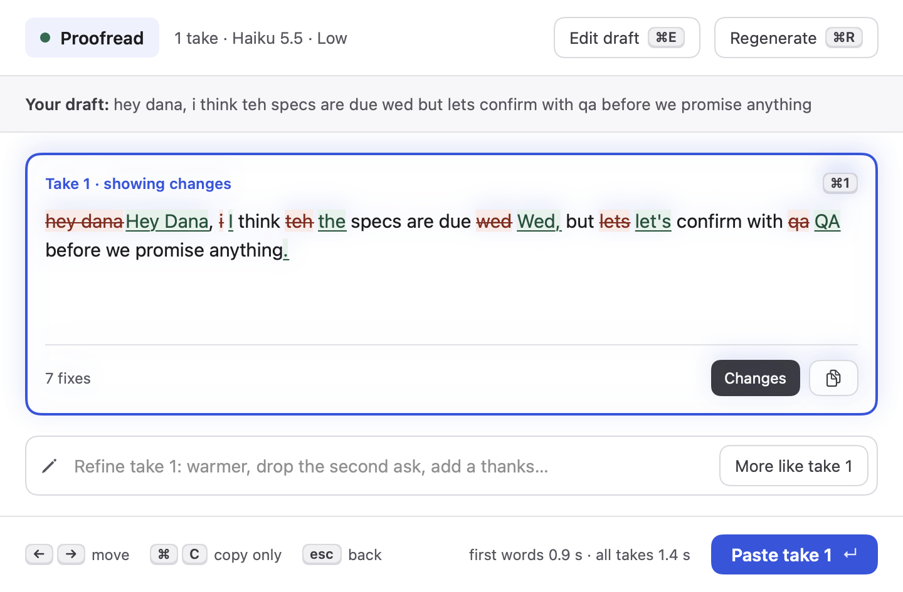
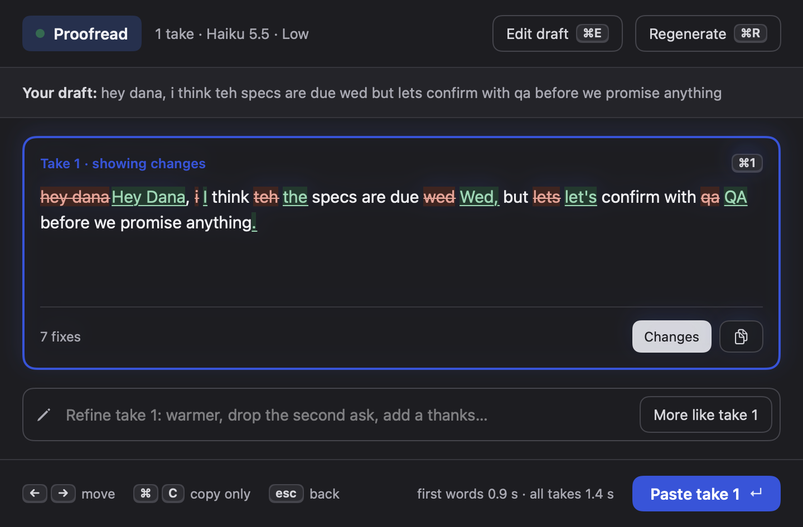
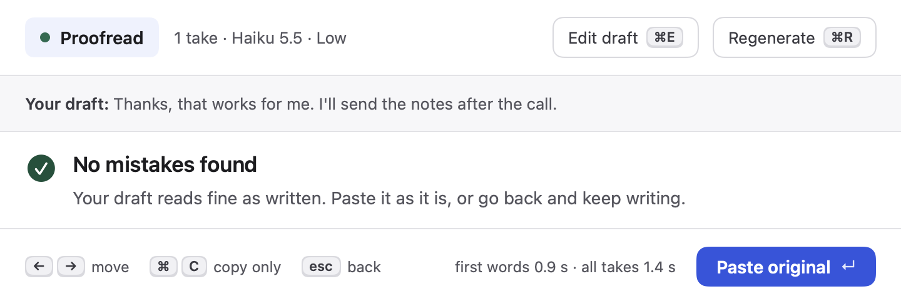
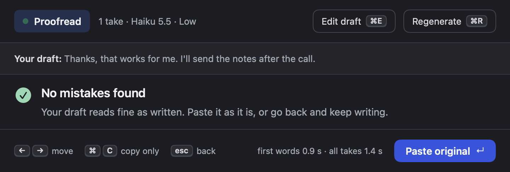
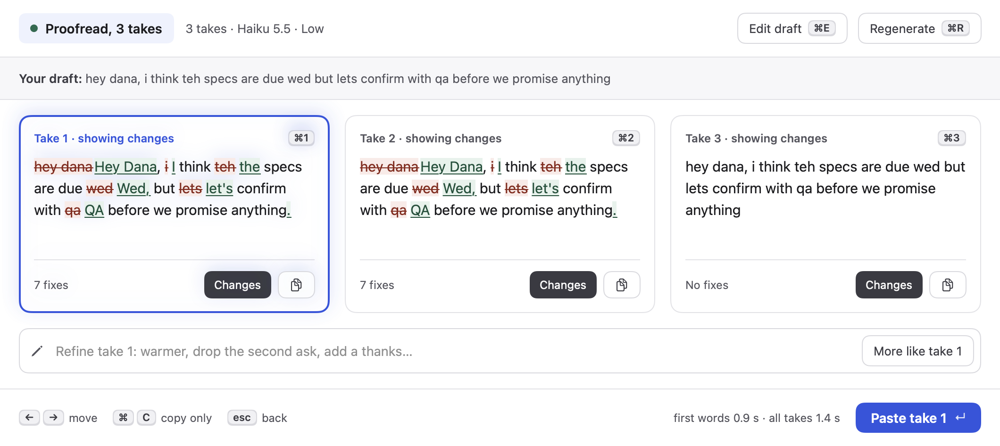
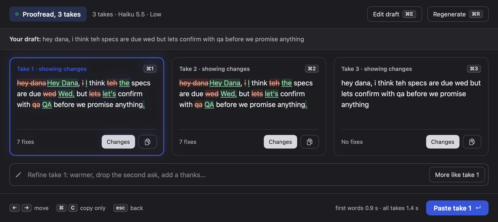
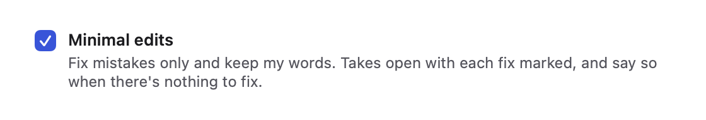
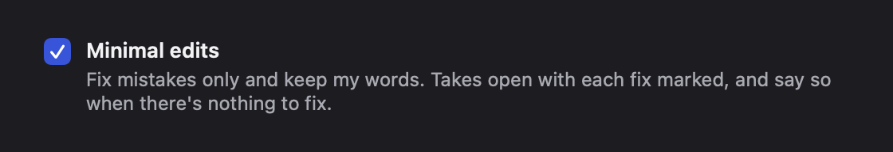

# 2 · proofread

## What changed and why

"Fix my mistakes, keep my words." Takes had a proofread preset, but it ran 1 Sonnet take through the same "rewrite"
prompt as every other preset and showed it as a plain take, so it was hard to see what changed, and when nothing was wrong
you got back an identical copy.

- **Proofread preset.** Fixes spelling, grammar, punctuation and clear typos only. Keeps wording, voice, tone, slang, line
  breaks, emoji, links, code and names. Never adds or removes content. 1 take, Haiku 5.5, low effort.
- **Minimal edits, for any preset.** A new checkbox in Settings › Presets ("Minimal edits") turns any preset into a
  proofread-style one, so people can make their own (for example "Proofread, Hebrew" or "Proofread, 3 takes").
- **Fixes marked inline.** Minimal-edit takes open with "Changes" already on: removed text is struck through, added
  text is underlined (not color alone), and the card footer says "4 fixes" instead of a word count.
- **"No mistakes found".** When nothing needed fixing, the panel says so instead of showing an identical take, and offers
  **Paste original ↵**, or Esc / ⌘E to go back.
- **A smarter diff** (all "Changes" views): punctuation at the start or end of a word is its own token, so an added comma
  marks only the comma; changes to neighbouring words join into one mark; spacing and line-break-only changes don't count as
  fixes; VoiceOver reads each change ("teh changed to the; capitalised Monday; added ,") and then the result.

## The flow

1. Pick **Proofread** (⇥ or ⌘1–9) and press ↵. The panel writes 1 take with Haiku.
2. **Fixes found:** the take opens with each fix marked and "N fixes" in its footer. ↵ pastes it, ⌘C copies, "Changes"
   toggles the marks off.
    
3. **Nothing to fix:** "No mistakes found", with Paste original ↵. Esc goes back to the draft.
    
4. A custom minimal-edits preset with 3 takes: each card shows its own fix count; an unchanged one says "No fixes".
    
5. Settings › Presets › any preset: "Minimal edits", under Run defaults.
    

## Settings and defaults

- `Preset.minimalEdits: Bool?` (new, last field of `Preset`). Optional on purpose: `Preset` uses synthesized Codable,
  so an optional decodes with `decodeIfPresent` and old presets.json files still load without a custom `init(from:)` (a
  non-optional field would make old files fail to decode and reset everyone's presets). Read it through `isMinimalEdits`
  (in `Proofread.swift`). Missing means off. See the shared note `proofread-preset-decoding.md` for the other sessions.
- `Preset.proofread`: id `builtin.proofread` (fixed, so the gallery can tell it's already added), Haiku 5.5, low, 1 take.
- **Fresh installs and existing users** (one-line hook in `Store.init`: `Proofread.upgraded(...)`): the old built-in
  "Proofread only, keep my words" preset is upgraded in place if its instruction was never edited. It keeps its id,
  color, hotkey, apps and examples; its name changes only if unchanged; the model moves to Haiku only if still on the old
  Sonnet/low default. Runs once (afterwards `minimalEdits` is set), and turning minimal edits off is remembered.
  Fresh installs get it the same way, through `Store.defaultPresets`.

## For the orchestrator

- **Gallery:** add `Preset.proofread` to `PresetGallery.all` (and `starters` if you want it on fresh installs). If
  `PresetGallery.starters` replaces `Store.defaultPresets`, either include `.proofread` there or keep the legacy entry so
  the upgrade hook still produces it. Match "already added" by id `builtin.proofread` or by `isMinimalEdits` + name,
  because upgraded presets keep their old random id.
- **Shared-file edits** (all small): `Store.swift` (field at end of `Preset`, one line in `init`), `Prompt.swift` (first
  line and multi-take line pick a proofread variant, rules appended, length line skipped for minimal edits),
  `PanelModel.swift` (`previewPreset` for snapshots, `changesShown` defaults on for minimal edits), `PanelViews.swift`
  (`NoFixesView` branch, footer paste button, fix count in the card footer, VoiceOver label on the diff, footer key hints
  no longer wrap in the 720 pt one-take panel: timing text gives way when there's no room, which was an existing bug),
  `PresetsTab.swift` (one `MinimalEditsSection` line after Run defaults), `Snapshot.swift` (one call),
  `Diff.swift` (rewritten tokenizer and grouping; `WordDiffTests` unchanged and passing).
- **Shortcuts:** none new. In the no-mistakes state ↵ pastes the original (same key as "paste take"), Esc goes back,
  ⌘E/⌘R as before.
- Voice rules still apply on top of minimal edits (for example "Spell these names exactly").

## Privacy

No change. Same draft, same engine; nothing new is read or sent. PRIVACY.md not edited.

## Research

- **Mobbin:** [Telegram AI Editor](https://mobbin.com/screens/a03c10da-4563-4593-80b5-88f14678944c) (a separate
  "Fix" mode next to "Style", original vs result) shaped making proofreading a mode with its own result view rather than
  just another preset; [Descript](https://mobbin.com/screens/dcb7a1b2-20ed-4014-a6d8-724463114e70) (marks on the
  exact words, "Correct all") shaped marking only the changed tokens, including lone punctuation. Grammarly and Apple Writing
  Tools (from the competitor review) for "keep my words" and "show what changed".
- **Affordance KB:** `ai-ux/trust-and-explainability.md` ("highlight what to check": mark the specific parts that changed,
  not the whole take; a review step before output leaves the user's hands is kept, ↵ to paste); `ai-ux/setting-expectations.md`
  (say what it does at the point of use: the preset's own instruction and the editor's one-line description);
  `ai-ux/ai-errors-and-uncertainty.md` (don't hand back an identical result as if it were work: say "No mistakes found");
  `auditing/checklist-macos.md`.

## Self-audit (checked against the snapshots)

- FBK-04 empty state explains and offers the action: "No mistakes found" + Paste original. ✓
- FBK-06 modes visible: "Take 1 · showing changes", the Changes chip is on, the count is in the footer. ✓
- CLR-02 one default button, Return triggers it: Paste take N / Paste original. ✓
- EFF-03 shortcuts shown on controls: ↵ on the paste button, ⌘E/⌘R in the header, esc in the footer. ✓
- Not color alone: strikethrough for removed, underline for added; both readable in light and dark. ✓
- VoiceOver: the diff has a spoken label with each change; the checkbox has a label and on/off value. ✓
- Copy: sentence case, no exclamation marks, says what happens. ✓
- Reduce Motion: no new animation. ✓
- Found and fixed: removed and added words ran together ("danaHey"), now a thin space separates them on screen; the
  footer hints wrapped ("mo/ve") in the one-take panel; the no-mistakes screen showed the draft twice.

## Tests added

- `ProofreadTests`: prompt with and without the flag (rules present, length and "meaningfully different" dropped, voice
  rules kept); built-in preset values; decoding presets saved without the field; round trip; upgrade of the legacy preset
  (kept fields, idempotent, user edits respected, turning off remembered); fresh installs get it; "nothing to fix"
  detection (trailing line break, double spaces, multiple takes, empty); fix counting and labels; spoken description.
- `WordDiffProofreadTests` (in `WordDiffTests.swift`): added comma marks only the comma; end punctuation; inner punctuation
  ("don't", URLs); capitalisation; rewrites group; line-break-only changes aren't fixes; emoji and links; rebuilding both
  texts; marks not by color alone. All existing `WordDiffTests` pass unchanged.

## Live check (done, 3 Haiku runs)

`claude -p` with the exact Proofread system prompt (built by `PromptBuilder`, default voice rules), `claude-haiku-5-5`,
low effort, lean flags as the app uses.

| # | Draft | Take |
|---|---|---|
| 1 | `hey dana, i think teh specs are due wed but lets confirm with qa before we promise anything` | `hey dana, i think the specs are due wed but let's confirm with qa before we promise anything` |
| 2 | ``lol yeah thats on me 🙈 the fix is in `parseDate()`, PR here https://github.com/acme/app/pull/42`` ⏎ `gonna merge after lunch` | ``lol yeah that's on me 🙈 the fix is in `parseDate()`, PR here https://github.com/acme/app/pull/42`` ⏎ `gonna merge after lunch` |
| 3 | `Thanks, that works for me. I'll send the notes after the call.` | identical (shows "No mistakes found") |

Edits stayed minimal: typos and apostrophes fixed; emoji, code, link, line break and slang kept; nothing added. Haiku
treated all-lowercase casual writing as the user's style and left "i"/"dana" lowercase. That matches "keep my voice";
if we want capitalisation fixed in casual drafts too, strengthen the capitalisation rule in `Proofread.rules`.

**Orchestrator live pass:** in a text box type `i think teh specs are due wed`, ⌃⌥Space, pick Proofread, ↵ → expect the
fixes marked and "N fixes", ↵ pastes. Then try a clean sentence → "No mistakes found", ↵ pastes it unchanged, Esc goes back.
Settings › Presets: an existing user who had "Proofread only, keep my words" now sees "Proofread" with Minimal edits on.
