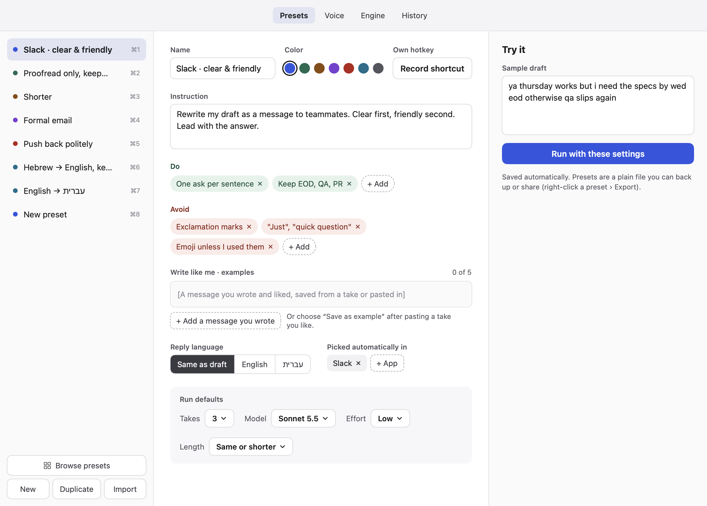
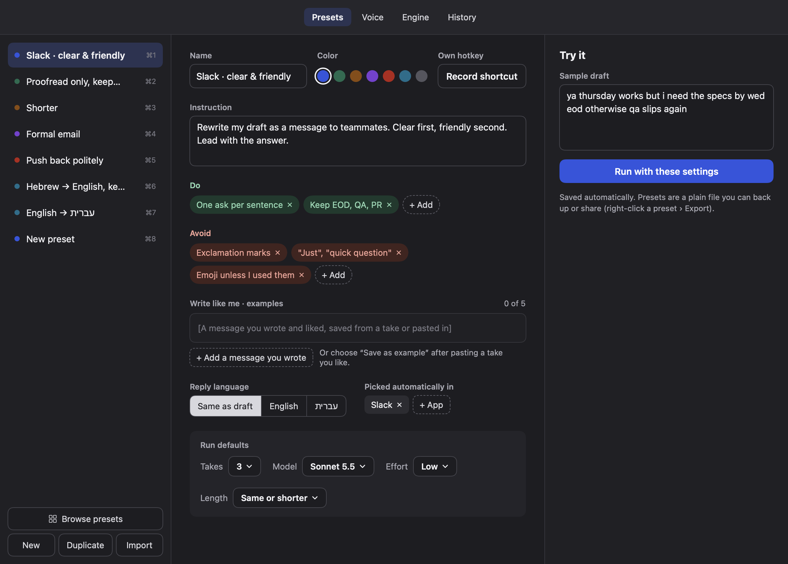
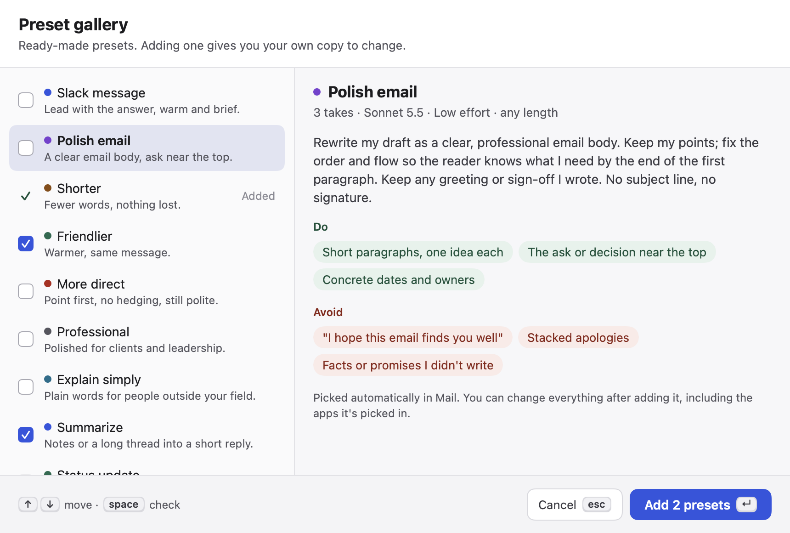
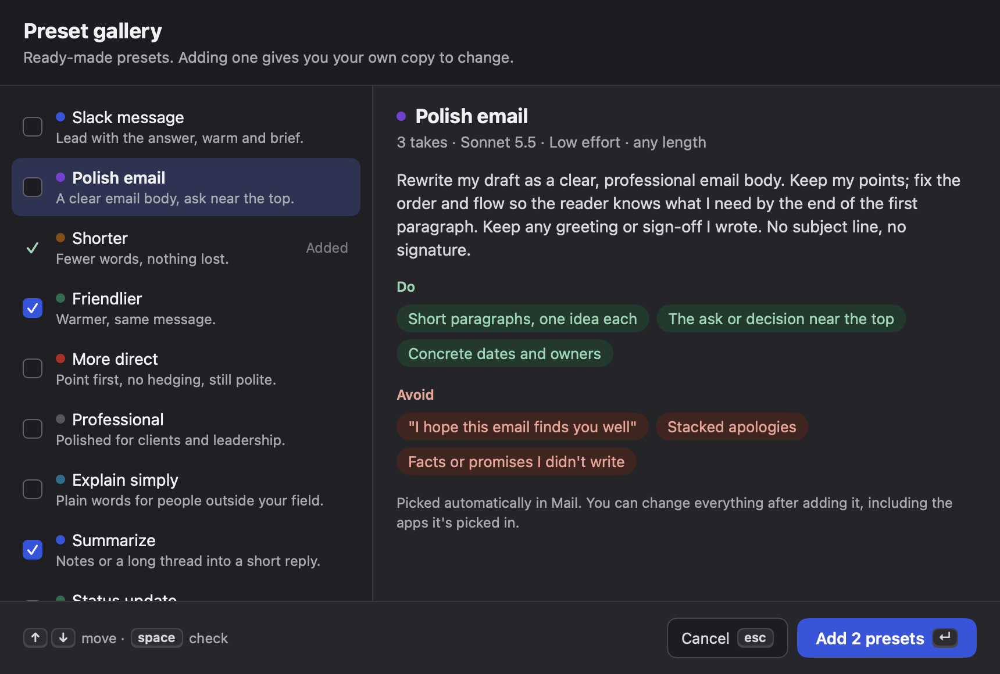
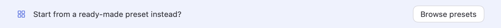
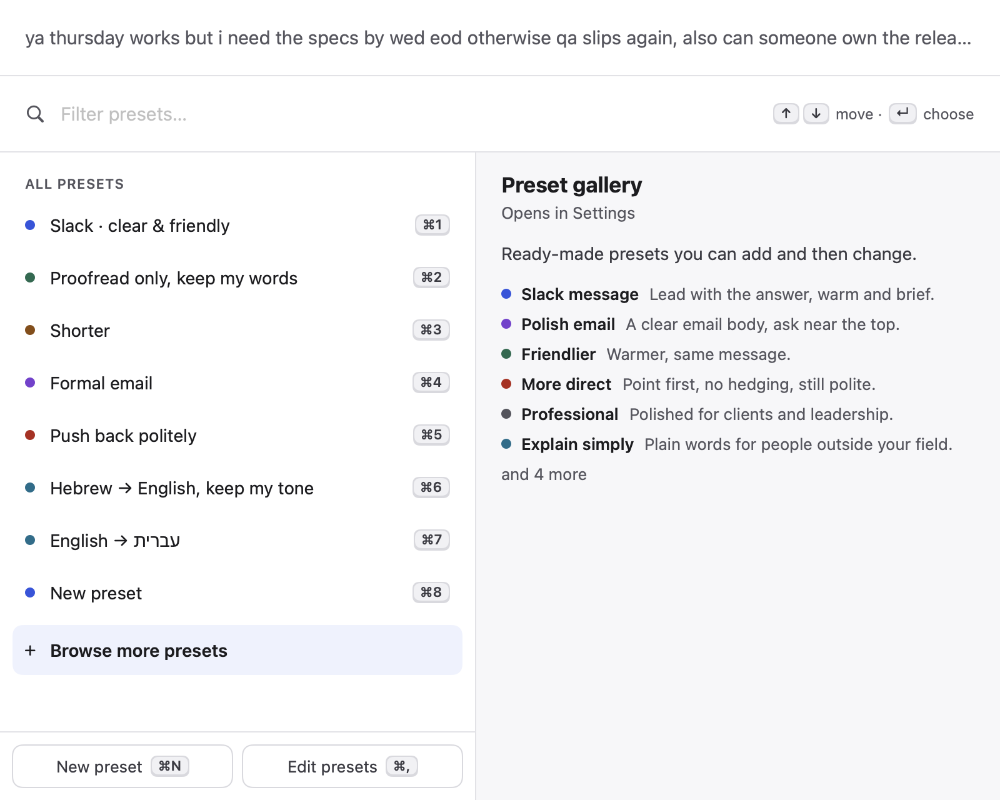
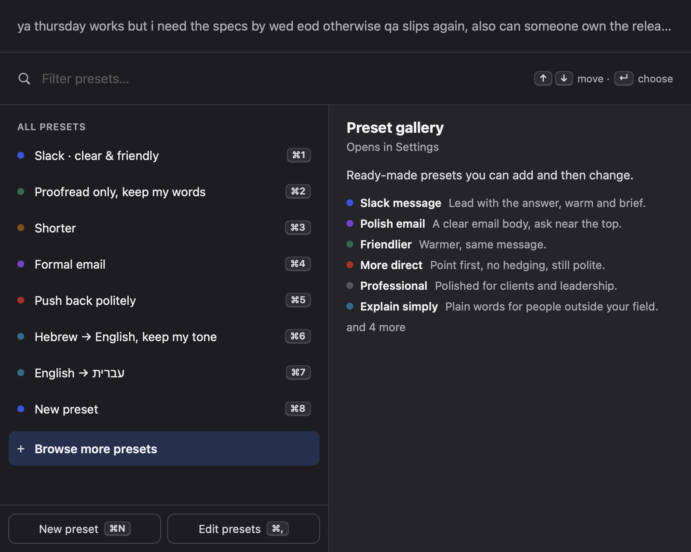

# 3 · Preset gallery

## What changed and why

Other writing tools come with ready-made actions. Takes made you write every preset yourself. Now there's a gallery of 11
ready-made presets. Browse them with a preview, check one or several, and add them. Each one you add is your own copy to
change. New installs start with six of them.

## The flow

1. **Settings › Presets.** A "Browse presets" button sits above New / Duplicate / Import.
    
2. **The gallery** opens as a sheet. On the left, each preset has a one-line description and a checkbox. Ones you already
   have show a checkmark and "Added". On the right is the same preview as the panel: instruction, Do and Avoid, run
   defaults, and the apps it's picked in. ↑↓ move, space checks, ↵ adds the checked presets (or the highlighted one if
   none are checked), double-click adds one, Esc closes. The button says what will happen: "Add “Polish email”",
   "Add 2 presets".
    
3. **After adding,** the sheet closes and the first new preset is selected in the editor.
4. **New preset.** After "New" (or ⌘N in the panel), a blank preset shows a bar: "Start from a ready-made preset
   instead?" › Browse presets. If you add from there, the blank "New preset" is removed. The empty state ("Choose a
   preset") also offers Browse presets.
   
5. **Panel picker.** While you have fewer than 8 presets, the list ends with a quiet "+ Browse more presets" row. It's
   also there whenever the filter matches nothing. Reach it with ↓ and press ↵, or click it. Its preview lists gallery
   presets you don't have yet. Choosing it closes the panel and opens Settings › Presets with the gallery.
    

## The presets (`Sources/Takes/PresetGallery.swift`)

Slack message (auto-picked in Slack), Polish email (auto-picked in Mail), Shorter, Friendlier, More direct, Professional,
Explain simply, Summarize, Status update, Decline politely, Translate to English. Each one has an instruction, Do and Avoid
rules, a color from `Preset.colors` and defaults of 3 takes, Sonnet 5.5, low effort.

**Starters** (fresh installs): Slack message, Polish email, Shorter, Friendlier, More direct, Decline politely.

**Prompt check, 4 Haiku 5.5 runs** (2 takes each, low effort, with the default voice rules):
- *More direct* on a hedgy "sorry to bother… maybe… no pressure" ask: led with the ask and kept Acme and Thursday, with no
  hedges left. One take ended with "Thanks!", so "Exclamation marks" was added to its Avoid list.
- *Decline politely* (hiring panel, Q4 planning): a clear no, one thanks, kept the user's reason and invented no alternative.
- *Summarize* (meeting notes): bottom line first, 3 short bullets, kept names, PR 4412 and dates exactly. No new conclusions.
- *Translate to English* (casual Hebrew): natural idioms ("on my case"), and the casual register and names were kept.

## Model and storage

- `Preset.galleryID: String?` was added at the end of the struct. It's optional, so old preset files decode unchanged (tested).
  The gallery uses it to mark presets as added. A preset with the same name, such as the old built-in "Shorter", also
  counts as added, so nothing is duplicated.
- `Store.init`: with no `presets.json`, new users get copies of `PresetGallery.starters`. Someone who already has
  `settings.json` (an earlier version) gets the old `Store.defaultPresets`, so nothing changes under them. Users with a
  presets file are untouched. The starter list is saved right away so its ids stay stable.
- `PanelModel`: `onOpenGallery`, `showsBrowseRow`, `browseRowHighlighted` and `browseRowLimit` (8). The browse row counts as one
  more row for ↑↓ and ↵.
- `SettingsState.showGallery`, plus `SettingsWindowController.show(tab:newPreset:gallery:)`.

## Settings and shortcuts

No new settings. No new global or panel shortcuts. The picker row uses the existing ↑↓ / ↵. Inside the gallery sheet:
↑↓, space, ↵ (default button) and Esc (cancel button), all local to the sheet.

## Privacy

None. The gallery is local data. Nothing new is read or sent, so PRIVACY.md is unchanged.

## For the orchestrator

- Add `Preset.proofread` (from `proofread`'s Proofread.swift) to `PresetGallery.all`. The spot is marked `// ORCHESTRATOR`.
  Consider adding it to `starters` too.
- `onboarding` can use `PresetGallery.starters`, and `PresetGallery.add(_:to:)` or `copy(of:)` to install picks.
- Shared-file edits are small: `Store.swift` (one field, init), `PanelModel.swift`, `PanelViews.swift` (one row, one
  preview branch), `PanelController.swift` (one hook), `SettingsWindow.swift`, `PresetsTab.swift` (sheet, button, hint bar,
  empty state; the editor itself is untouched), and `Snapshot.swift` (one line).
- **Live check:** (1) In Settings › Presets, click Browse presets. Check two, press ↵, and see both added and the first one
  selected. Reopen and see them marked Added. (2) Click New. The hint bar shows. Browse and add one, and the blank preset is
  gone. (3) With fewer than 8 presets, press ⌥⇧Space, then ⇥, ↓ to the last row, ↵. The panel closes and the gallery opens
  in Settings. (4) Type a filter that matches nothing. The row shows and ↵ opens the gallery. (5) Fresh install: move
  `~/Library/Application Support/Takes` aside, launch, and see the 6 starters.

## Research

- Affordance KB: `flows/first-use-and-empty-data.md` (starting blank is hard, so offer templates; the empty state names one
  next action), `flows/search-and-discovery.md` (results show title, description and preview; a filter with no results
  offers a browse path, which is why the row also shows on no matches), `macos/settings-window.md` (changes apply right
  away, no Apply button), `macos/keyboard-shortcuts.md` and `auditing/checklist-macos.md` (one default button on ↵, Esc
  cancels, keyboard-reachable rows), `ai-ux/setting-expectations.md` (scoped actions with plain task names and
  descriptions).
- Mobbin: Notion AI's instruction picker (a description per preset, then "Browse templates" at the end of the menu), which
  shaped the picker row. v0's marketplace (list plus detail, an add state per row) and the Base44 template modal (preview
  first, one primary action) shaped the sheet. Notion's template gallery and Browserbase's templates sheet were also
  reviewed. None of them shows multi-add or an "Added" state, so those are our own.

## Self-audit

- One default button (↵) and a cancel button (Esc). The primary button names exactly what it will add and is disabled
  when nothing can be added.
- Every row and control has a VoiceOver label: checkboxes "Add <name>", rows report Added or Checked, the browse row has a
  hint. Decorative icons are hidden from VoiceOver.
- Light and dark mode checked in the snapshots. Only Theme colors and Spacing values are used. No animation, so Reduce
  Motion has nothing to change.
- Copy is in sentence case with no exclamation marks, and says what happens ("Opens in Settings", "Already in your
  presets. Edit it there.").
- Known limit: the panel picker's list doesn't scroll to keep the highlighted row visible (an existing behavior). The
  browse row only shows with fewer than 8 presets, which fits the panel's height.

## Tests

`Tests/TakesTests/PresetGalleryTests.swift`: fresh install gets starters, existing users keep the old defaults, adding makes
an independent copy with a new id, no duplicates (including by name), all gallery presets are valid (unique ids and names,
house colors, valid model, effort and takes, Do and Avoid present, no em dashes), untouched-new detection, decoding old
presets without `galleryID`, and the picker browse row (shown, highlighted, ↵ opens the gallery, hidden with many presets,
shown on no matches). `swift test`: 57 tests, 0 failures.
