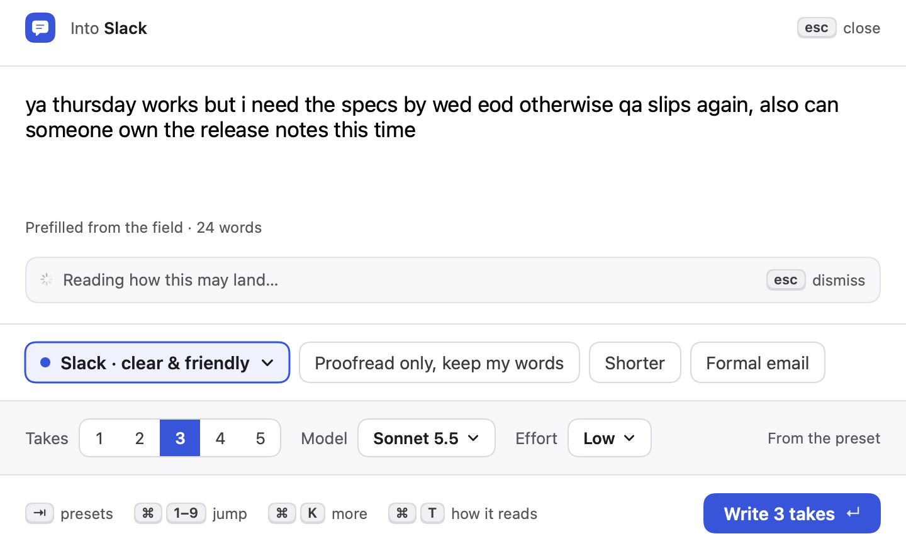
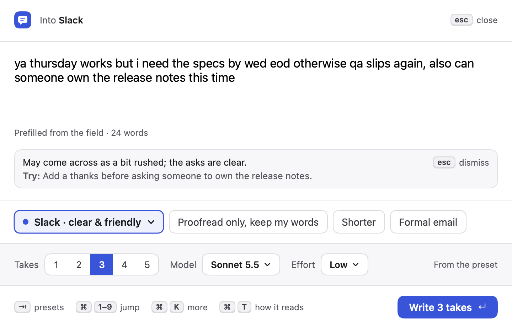
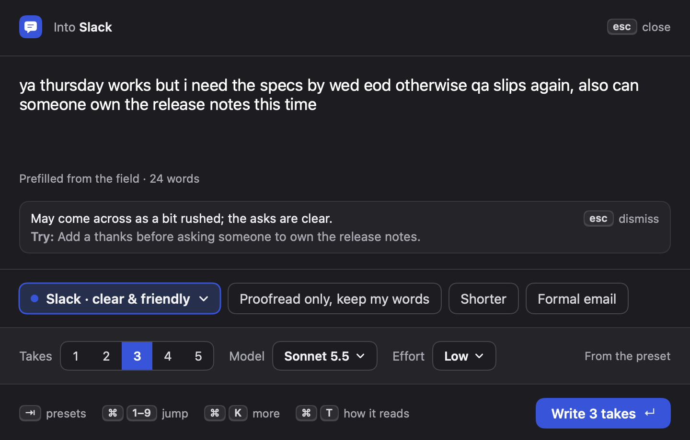
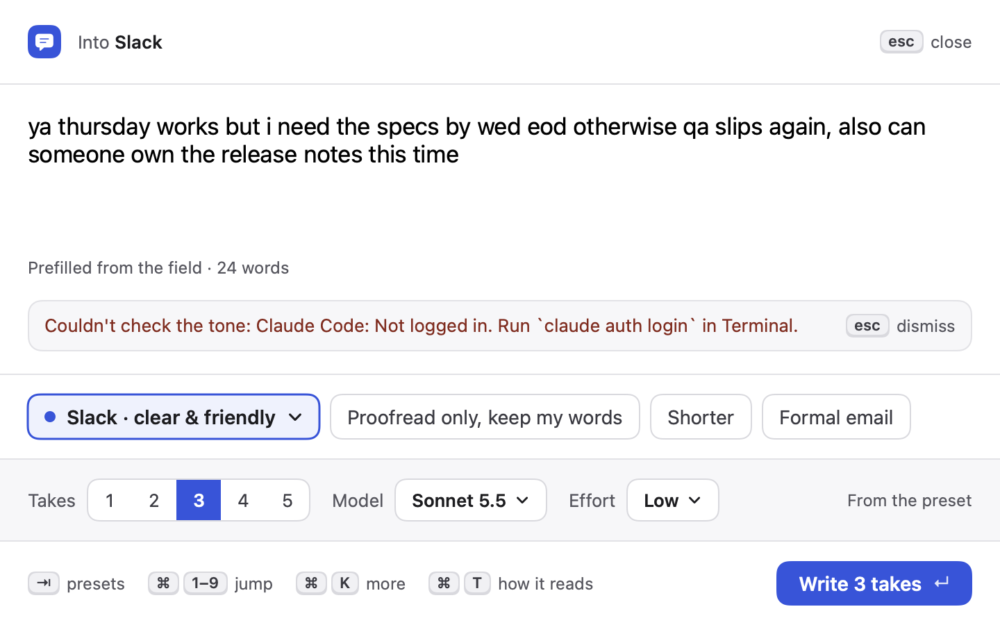
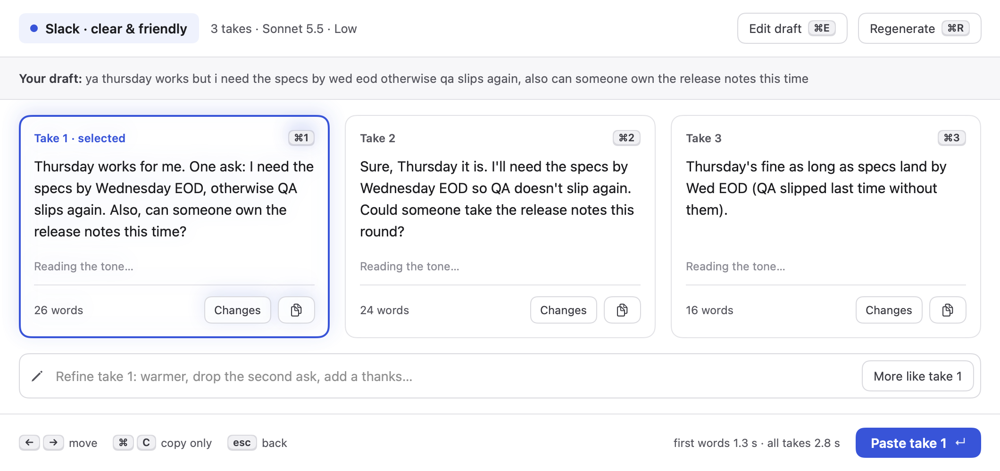
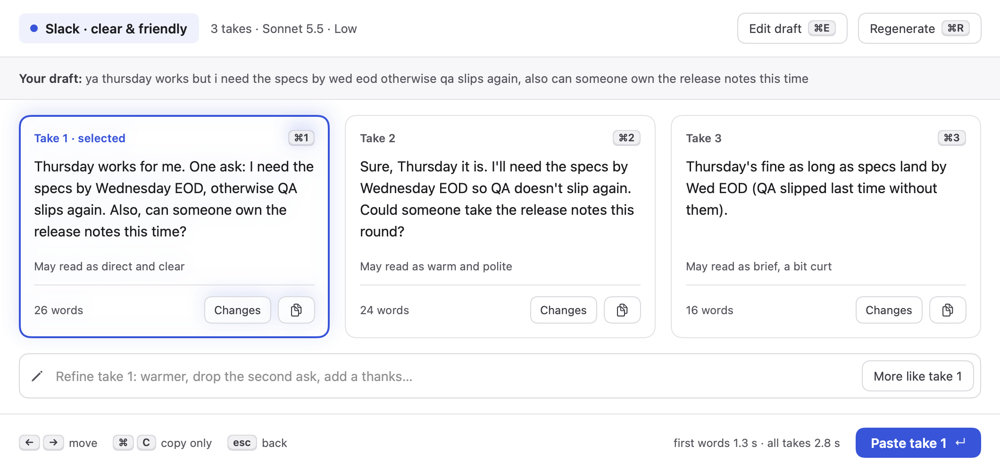
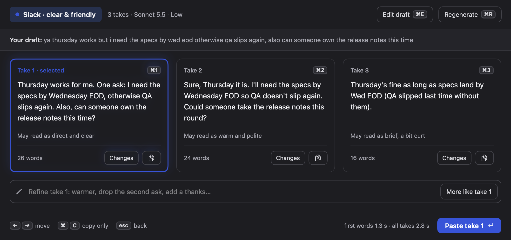
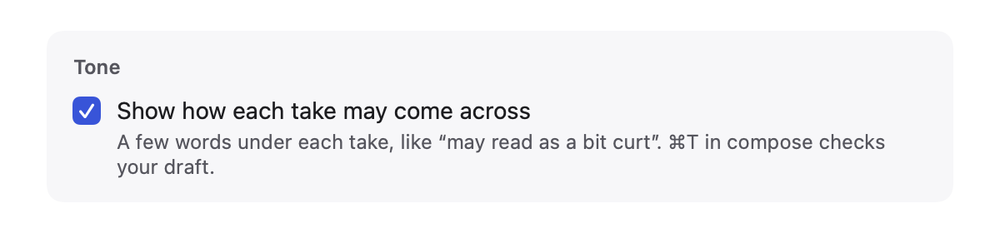
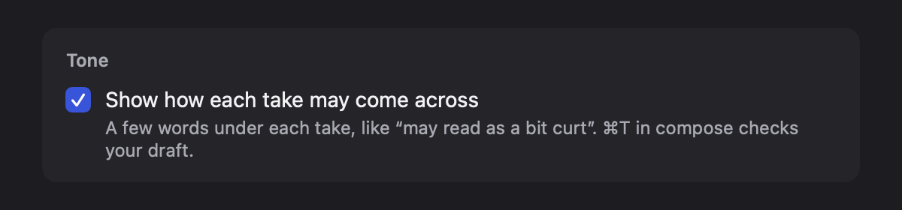

# 5 · Tone check

## What changed and why

Before you paste, you can now see how a message may land.

- **Each take gets a short note** under its text: "May read as warm and polite", "May read as brief, a bit curt". It fills in a few seconds after the takes are written and never delays them.
- **⌘T in compose ("how it reads")** checks your own draft: one line on how it may come across, plus at most one concrete thing to try. It shows inline under the draft, you can keep typing, and it disappears as soon as the draft changes. Esc dismisses it.
- **One switch per preset**, "Show tone" (on by default), at the end of the preset editor. Off means no tone requests at all for that preset, and the ⌘T hint is hidden.

The wording is hedged and about the words, never the writer ("may read as", "may come across as"), following the Affordance KB on calibrated trust: a tone read is a guess, so it is phrased as one and never blocks anything.

## The flow

1. Write a draft. The footer shows **⌘T how it reads** next to the other hints.
   - While it's checking: 
   - The read, with one hint:  (dark: )
   - If it fails, it says why in the same place; nothing else is blocked: 
   - Editing the draft drops the read (a read of older words would mislead). Esc dismisses it first, then a second Esc closes the panel as before.
2. Press ↵. Takes stream in exactly as before.
3. Once all takes are written, each card shows "Reading the tone…" in faint text, then its note. The line keeps its height, so cards don't jump when notes arrive.
   -  (dark: )
   -  (dark: )
   - If the note request fails, the line stays blank. A missing note isn't worth an error; the takes are what matter.
4. Settings › Presets › (preset), at the end of the form:  (dark: )

## Inline vs separate call: measured

The brief suggested asking the writing model for a tagged `[tone]` line per take, parsed out of the stream. I built and measured that first, then the alternative. `Takes --bench --tone inline|separate` reproduces it (Claude Code, Sonnet 5.5, low effort, 3 takes, the README's sample draft). The Mac was busy with 7 other sessions, so I interleaved plain and inline runs back to back:

| Pair | Plain: all takes | Inline `[tone]`: all takes |
|---|---|---|
| 1 | 4.2 s | 6.5 s |
| 2 | 4.5 s | 7.2 s |
| 3 | 5.3 s | 9.8 s |
| 4 | 3.6 s | 5.7 s |

Inline made the takes 2–4.5 s slower every time (more than the ~10 extra tokens per take explain; first words were often later too). On Haiku only 1 of 3 takes came back with a note. The separate Haiku call (`ToneCheck.takesRequest`) doesn't touch the writing run at all; its notes arrived 4–9 s after the takes on the loaded machine (most of that is Claude Code starting up a second time), 3/3 notes in 3 of 4 runs. The one miss came from an earlier prompt, which I then changed to numbered lines (`1: warm and clear`), parsed by `parseTakeTones`.

**Picked: the separate Haiku call.** Takes' speed to the takes is the product's main promise, and a note that arrives a few seconds later is fine for something you glance at. Cost: one small Haiku request per run (the takes text in, ~20 tokens out), none when "Show tone" is off. ~20 engine calls were used for the whole measurement.

## New settings

| Setting | Where | Default |
|---|---|---|
| Show tone (per preset, `Preset.showTone`) | Settings › Presets, last section | On |

Presets saved before this change load with it on. This needed a tolerant `Preset` decoder (`extension Preset { init(from:) }` in `Store.swift`): before, the synthesized decoder required every key, so adding any `Preset` field would have made old `presets.json` files fail to load and reset to the defaults. **Orchestrator:** other sessions that add `Preset` fields need the same decoder; keep one extension and add a `decodeIfPresent` line per field (also noted in the shared notes folder).

## New shortcut

- **⌘T** in compose: "How does this read?" Only when the preset shows tone and the draft isn't empty. Not used elsewhere in the panel (compose has ⌘1–9, ⌘K, ⌘,; takes has ⌘1–5, ⌘E, ⌘R, ⌘C). Please check against the other sessions.
- **Esc** in compose now dismisses a shown tone read before closing the panel.

## Privacy

Tone notes use the same route as takes (Claude Code or the API key, the user's own account), only to Anthropic. With "Show tone" on, the finished takes are sent once more to Claude Haiku; ⌘T sends the current draft, only when pressed. Notes aren't stored (not in history, not in logs). Added a paragraph to `PRIVACY.md` › "Where your text goes".

## Files

- `Sources/Takes/ToneCheck.swift`: prompts, requests, parsing, `TakeTones` (notes for the shown takes) and `ToneReadModel` (the ⌘T read).
- `Sources/Takes/ToneCheckViews.swift`: `TakeToneLine`, `ToneReadHint`, `ToneReadSection`, `PresetToneSection`.
- `Sources/Takes/ToneBench.swift`: `--bench --tone inline|separate`.
- `Sources/Takes/Snapshot+ToneCheck.swift`: tone screens, light and dark.
- Hooks in shared files: `PanelModel` (two properties, reset/dismiss calls, Esc, one `fetch` call in `finish`), `PanelViews` (three one-line view insertions: under the draft, in the compose footer, in `TakeCard`), `PresetsTab` (one line at the end of the editor form), `Store` (`showTone` at the end of `Preset` + tolerant decoder), `Bench` (one line dispatching `--tone`), `Snapshot` (one call). The writing prompt (`Prompt.swift`) is unchanged.

## Tests

`Tests/TakesTests/ToneCheckTests.swift` (21 tests): numbered note parsing (all present, missing lines, out of order and other separators, malformed and over-long lines, duplicate numbers, the last line while streaming), cleaning (acronyms kept, quotes stripped), hedged labels, toggle off makes no request and starts no call, request building (Haiku, low effort, numbered messages, "never the writer", text-not-instructions), the draft read (with and without hint, unlabelled fallback, empty fails), the read dropped on draft change, and decoding old and minimal presets plus a round trip. `swift test`: all pass. `./build.sh`: no warnings.

## Self-audit (Affordance)

- `ai-ux/trust-and-explainability`: notes are hedged ("may read as"), never shown as fact or as a score; no confidence numbers. The prompt asks for mild words about the message, not the writer.
- `ai-ux/ai-errors-and-uncertainty`: failure of the draft read says what went wrong and how to retry (⌘T); a failed take note fails silently, since it's optional and the takes are unaffected. The read can be dismissed (Esc) and goes away on edit, so a stale read is never shown.
- `ai-ux/setting-expectations`: the settings line says exactly what appears and where.
- `content/voice-and-tone`, `ux-writing-principles`: sentence case, no exclamation marks, plain words ("how it reads", "Reading the tone…").
- `macos/keyboard-shortcuts`: ⌘T shown on its control as a keycap; Esc backs out one step.
- Light and dark checked on every screen; VoiceOver labels on the hint button ("How does this read?"), the dismiss button and each note ("Tone: may read as …"); the note's fade-in is off under Reduce Motion.
- Layout: the note line reserves its height so cards don't shift; spacing and colors only from `Theme`/`Spacing`.

Research: Mobbin search for tone detectors in writing tools. Square's "Write with AI" (tone as a compact field next to the message) and Klaviyo's voice-and-tone picker (2–4 word descriptors like "Warm and approachable") shaped the short phrase format. Grammarly's tone detector and Reader Reactions (from the competitor review) shaped the idea; I kept it to text, without emoji or a score.

## Live check for the orchestrator

1. In a text box, write "ya thursday works but i need the specs by wed eod", press ⌘T: a read appears under the draft within a few seconds. Type a letter: it disappears. ⌘T again, then Esc: it disappears and the panel stays open; Esc again closes it.
2. Press ↵: takes appear as fast as before; a moment later each card shows "May read as …". Paste one: only the take is pasted.
3. Settings › Presets › that preset › untick "Show tone". Write takes again: no tone lines, and no ⌘T hint in compose.
4. With an API key engine, repeat 1–2 once.
