# 6 · Dictation

## What changed and why

You can now speak your draft instead of typing it. Press ⌘D in the panel (or click **Dictate**), talk, and your words appear in the draft at the caret as you speak. Press ⌘D or Esc to stop, or ↵ to stop and write the takes right away.

Speech is turned into text on your Mac only, with Apple's on-device speech recognition (`requiresOnDeviceRecognition = true`). The audio never leaves the Mac. If the Mac has no on-device model for the language, Takes says so and doesn't dictate; it never falls back to Apple's servers.

## The flow

1. **Compose, idle.** A small **Dictate ⌘D** button sits at the right end of the status line under the draft (where Dropbox Dash and Copilot put their composer mic).
   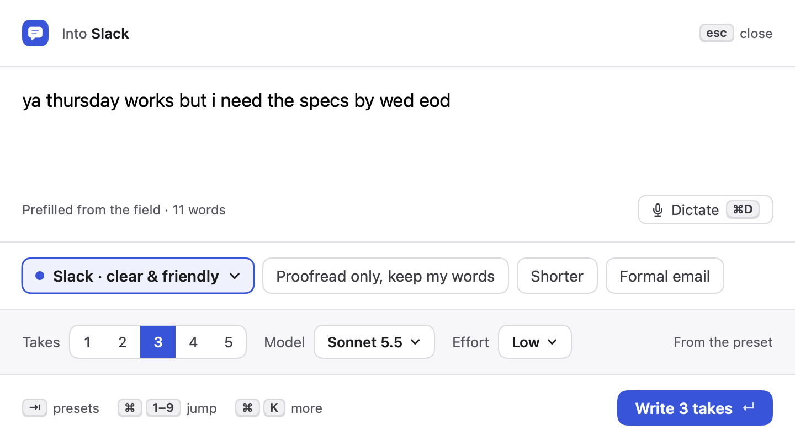 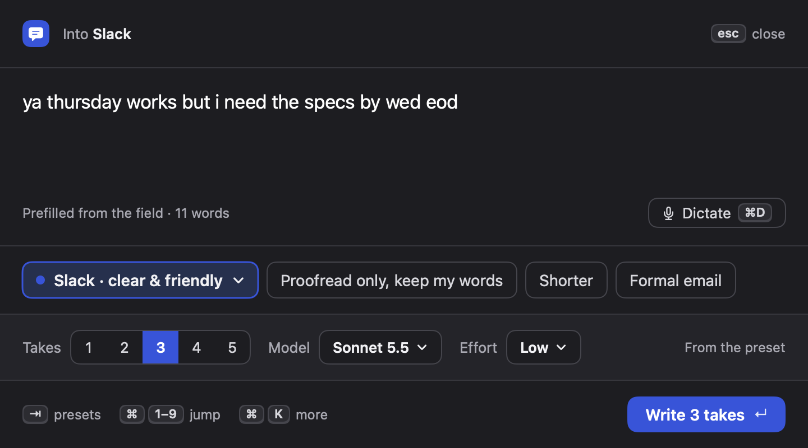
2. **First use only: a short note** in place of the status line says what happens and that audio stays on the Mac, with **Not now (esc)** and **Continue (↵)**. macOS's own dialogs (microphone, then speech recognition) follow only after Continue.
   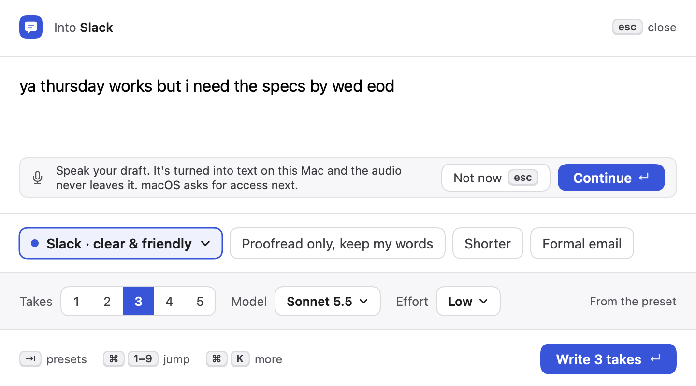 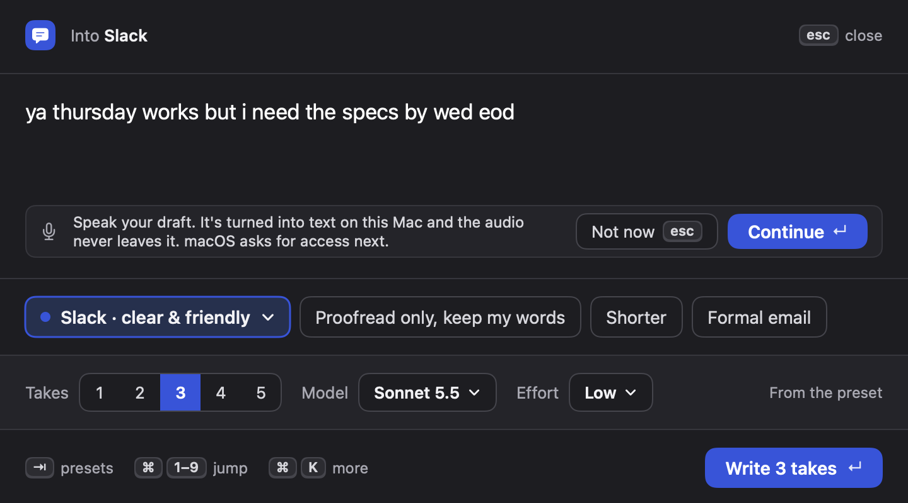
3. **Listening.** A red dot, "Listening in English (US)", a five-bar level meter, "↵ write takes" and **Stop ⌘D**. The words settle into the draft live; each partial replaces the previous one at the caret. A selection is replaced, as with macOS dictation. Typing any key stops dictation and keeps the words, so the box is the keyboard's again. macOS also shows its orange mic dot in the menu bar.
   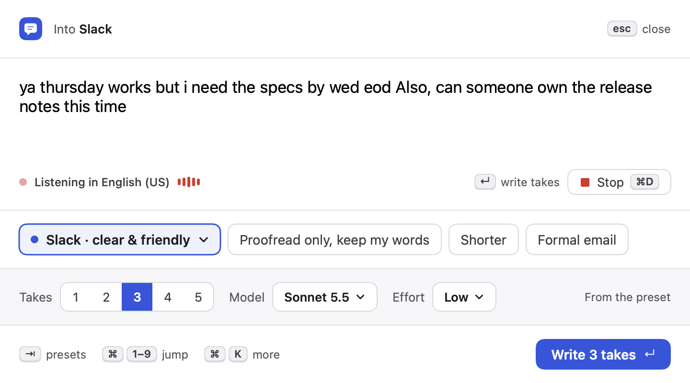 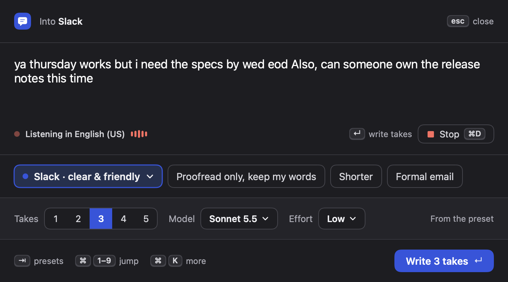
4. **Stopping.** ⌘D or Esc stops the microphone and waits up to 1.2 s for the final words ("Finishing…"), then goes back to idle. A second Esc closes the panel as before.
5. **Access off.** If either permission was refused, the note says which one and where to turn it on, with **Open System Settings (↵)** that opens that exact Privacy pane. While the note is up Takes checks once a second and clears it as soon as access is on (it never starts listening by itself).
   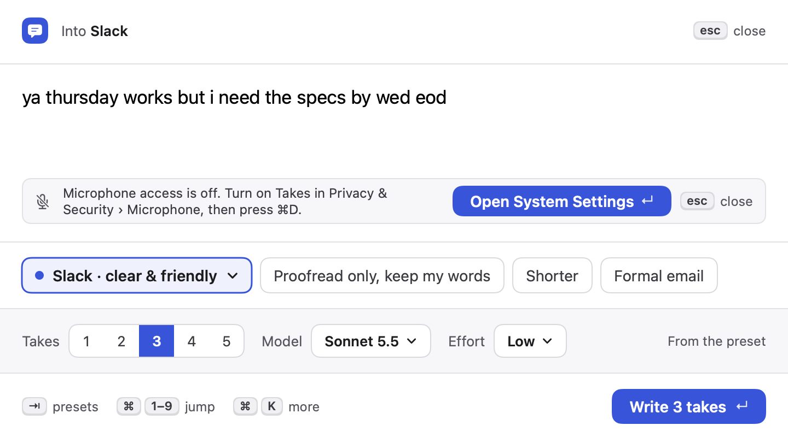 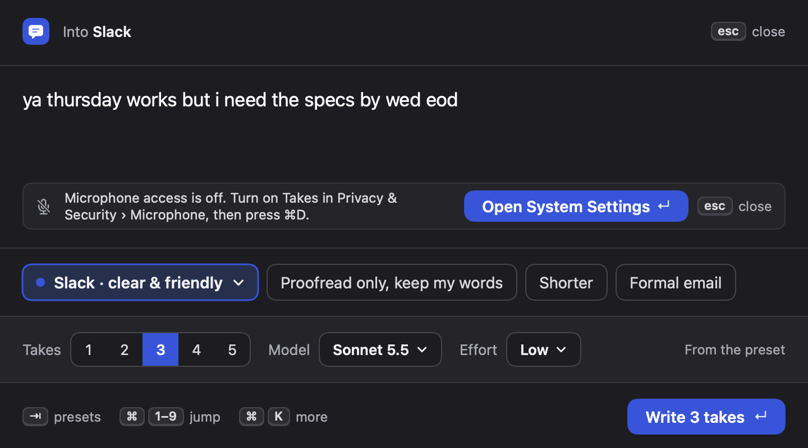
6. **Language not on this Mac.** "No on-device speech for Hebrew (Israel) yet. Add it in Keyboard › Dictation, or pick another language in Settings." with **Keyboard Settings (↵)**. Also: "No microphone found…" and "Dictation stopped: … Press ⌘D to try again." for recognizer errors. Silence or "no speech detected" ends quietly.
   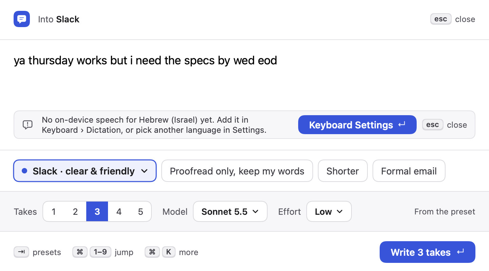 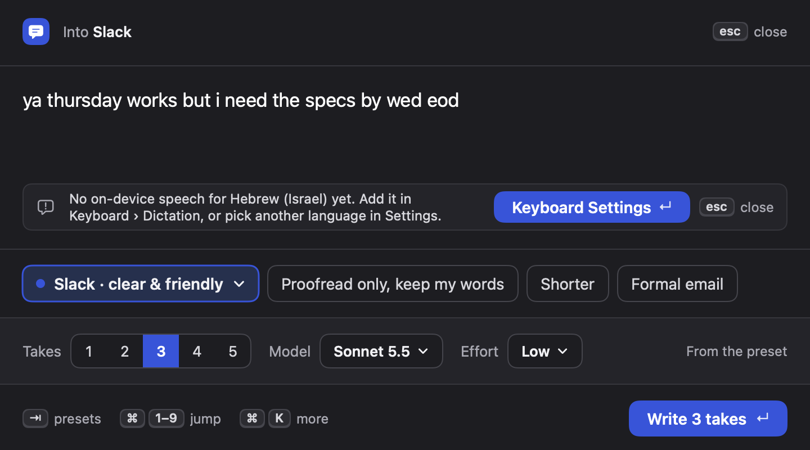

Leaving compose (presets, takes, closing the panel, a new summon) always turns the microphone off.

## New settings

- **Settings › Engine › Dictation › Language**: default **Same as macOS**. Lists only languages with an on-device model. Stored as `AppSettings.dictationLanguage` (locale identifier, empty = system), decoded with `decodeIfPresent`.
  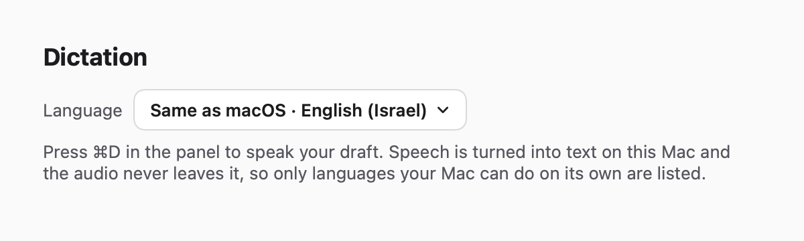 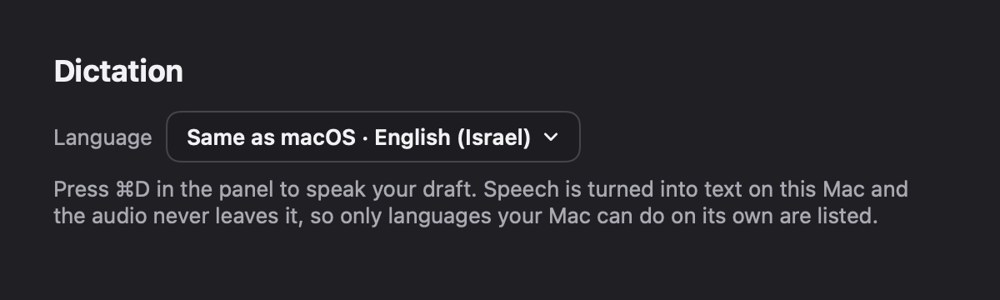

## New shortcuts (compose screen only)

| Key | Action |
|---|---|
| ⌘D | Start dictating / stop (in a note: close it) |
| Esc | While dictating: stop (keeps the words). On a note: close it. Otherwise unchanged (close the panel). |
| ↵ | While dictating: stop and write takes. On a note: its primary action (Continue / Open System Settings / Keyboard Settings). Otherwise unchanged. |

⌘D isn't used by the panel (README: ↵ ⇧↵ ⇥ / ⌘1–9 ⌘K ⌘, ⌘C ⌘E ⌘R ⌘N) or by NSTextView, and no other worktree in this wave used it when I checked.

**Toggle, not hold-to-talk**, because: drafts run to a few sentences and holding a chord that long is tiring and hard for people with motor impairments; macOS Dictation itself is a toggle; SwiftUI shortcuts only fire on key down, so hold would need a raw key-up monitor in a panel that never activates; and holding ⌘ while speaking risks firing other ⌘ shortcuts.

## Files

- New: `Dictation.swift` (state machine, `DictationInsertion`, `SpeechBackend` protocol, `SystemSpeech` = AVAudioEngine + SFSpeechRecognizer), `DictationViews.swift` (status row, mic button, level meter, notes, settings section), `Snapshot+Dictation.swift`, `Tests/TakesTests/DictationTests.swift`.
- Hooks in shared files: `PanelModel` (dictation property, `toggleDictation`, `submitDraft`, `insertDictated`, Esc routing, stop on screen change/reset), `PanelViews` (status line wrapped in `DictationRow`, ⌘D shortcut button, draft `minHeight` 96 → 80 so a two-line note fits the fixed 400 pt compose screen), `TextInputs` (`DraftEditor` gets `caret`, `onSelection`, `onType`, all defaulted), `PanelController` (stop on close, take key back after macOS dialogs), `Store` (one field at the end), `EngineTab` (one section at the end of the right column), `Theme.recording` (new color: recording must read red; `avoidText` is too muted), `Snapshot` (one line), `scripts/assemble-app.sh` (two usage strings).

## Status API for onboarding

`Dictation.permissionState` → `.notAsked`, `.allowed` or `.denied(.microphone / .speech)`. It reads the TCC status only and never prompts. I didn't touch `Setup.swift`: dictation is optional, so it isn't a setup step. Onboarding can show it as an optional row; asking should happen at first use, as here.

## Privacy impact

New section "Dictation" in `PRIVACY.md`: off until used, microphone only while dictating, on-device recognition only, no audio files, nothing sent anywhere; dictated words are part of the draft and go to Anthropic only when you ask for takes. Info.plist purpose strings:

- `NSMicrophoneUsageDescription`: "Takes listens only while you dictate a draft (⌘D in the panel). Your speech is turned into text on this Mac and the audio never leaves it."
- `NSSpeechRecognitionUsageDescription`: "Takes turns your dictated draft into text on this Mac, using on-device speech recognition only. Nothing is sent to Apple or anyone else."

## ⚠️ Release signing: entitlement needed

Release builds are signed with the hardened runtime (`scripts/sign-app.sh`, `--options runtime`). Under the hardened runtime, microphone input needs the `com.apple.security.device.audio-input` entitlement, or the mic delivers silence/fails with no prompt. I don't own the release scripts, so this isn't done. The orchestrator should add an entitlements plist with that key and pass `--entitlements` when signing the app (not Sparkle's nested code). Dev builds (`./build.sh`, ad-hoc, no hardened runtime) don't need it.

## The non-activating panel

Reasoning: audio capture (AVAudioEngine) and SFSpeechRecognizer don't require the app to be active or frontmost on macOS; TCC grants are per app, not per window, and Takes is an accessory app that keeps running. The panel stays key without activating Takes, so ⌘D/Esc/↵ still arrive. The one known risk is the macOS permission dialogs: answering them may move key focus away from the panel, so after the dialogs Takes calls `panel.makeKey()` (`Dictation.onRegainFocus`). Headless I verified the state machine, key routing and insertion with a fake backend, and that the built app's Info.plist has both usage strings. I didn't capture audio (brief: no live desktop driving).

## Live check for the orchestrator

1. Reset permissions: `tccutil reset Microphone com.baramir.takes` and `tccutil reset SpeechRecognition com.baramir.takes`. Build and open Takes.
2. In TextEdit, press ⌥⇧Space. Confirm TextEdit stays the active app (menu bar says TextEdit).
3. Press ⌘D: the explanation note appears. Press ↵: macOS asks for the microphone, then speech recognition. Allow both. Check the panel still takes keys (type a letter in the draft) and that recording started (red dot, meter moves when you speak, orange mic dot in the menu bar).
4. Put the caret in the middle of the draft, press ⌘D, say a sentence: the words appear at the caret and revise in place. Press ⌘D: "Finishing…", then idle with the words kept.
5. Press ⌘D, speak, then type a key: dictation stops and the letter is typed after the words. Press ⌘D, speak, press ↵: takes are written from the draft with the spoken words.
6. Press ⌘D then Esc: stops. Esc again closes the panel; the orange mic dot goes away.
7. Turn the microphone off for Takes in System Settings, press ⌘D: the "Microphone access is off" note, ↵ opens the Microphone pane; turn it on and see the note clear within a second.
8. Settings › Engine › Dictation: pick a language your Mac has no on-device model for (or turn off Dictation in Keyboard settings), press ⌘D: the "No on-device speech" note; confirm no network traffic (Little Snitch or `nettop -p Takes`).
9. Turn on Reduce Motion: the red dot stops pulsing and the meter steps without easing.
10. Repeat step 3 with a hardened-runtime release build (after the entitlement above).

## Research

- Affordance KB: `flows/permission-requests.md` (ask in context, honest primer with equal "Not now", recovery through a labelled deep link, detect the grant on return), `macos/mac-install-update-permissions.md` (prompted-at-first-use TCC, specific purpose strings, mic indicator), `ai-ux/voice-and-multimodal.md` (a clear listening state, push-to-talk vs open mic, speech for intent and the screen for review), `auditing/checklist-macos.md`.
- Mobbin: [Dropbox Dash](https://mobbin.com/screens/4178e3ee-5db3-4b7b-8f1a-2259c2087543) and [Microsoft Copilot](https://mobbin.com/screens/9a7bcfd1-0e4f-4201-b9d4-4c3318d28340) (quiet mic at the trailing end of the composer), [Plane AI](https://mobbin.com/screens/e9cd6480-757c-460e-961a-baec177562e4) ("Recording…" replacing the composer row in place, with stop/confirm), [Voicenotes](https://mobbin.com/screens/7f11d8a2-50d7-4f5b-a9f4-f232f6d01010) (red record dot, Done).

## Self-audit (against the snapshots)

- Status visible: the listening state has a distinct dot, label, live meter and stop control (voice-and-multimodal "never listen without a visible signal"). Passed.
- Permission primer: shown only on first use, one sentence of benefit, equal Not now, not styled like the system alert; no prompt before the user acts. Passed.
- Denied path: says which permission and where, button labelled for its destination, opens the exact pane, notices the grant without relaunch. Passed.
- Errors say what went wrong and what to do (no "something went wrong"). Passed.
- Keyboard: every action has a shortcut shown on its control; Esc backs out one step. Passed.
- Light and dark, VoiceOver labels on the mic button and notes, meter and dot hidden from VoiceOver, Reduce Motion respected. Passed.
- Layout: notes are capped at two lines so the fixed-height compose screen doesn't clip the header or footer (it did before I shortened the copy and lowered the draft's min height). Fixed.
- Known: the recording snapshot catches the dot mid-pulse, so it looks lighter than it is live.

## Tests added (`DictationTests`, 29 tests)

Insertion at the caret (end, middle, selection replaced, partials replace each other, punctuation spacing, empty transcript, clamping, UTF-16 caret with emoji and Hebrew); permission state mapping; state machine (idle → recording → stopping → idle, stop timeout, first-use explain → asking → recording, Not now, mic refused, speech refused, already denied, denied note clears on grant without auto-start, no on-device model is unavailable and never starts, no microphone, recognizer error, silence ends quietly, stale callbacks ignored); panel keys (Esc stops before closing, ⌘D start/stop/finish, ↵ continues the note instead of writing, words at the caret then typing takes over, a new recording starts at the new caret, leaving compose stops listening); settings decoding of old files.
