# 7 · local-models: write takes with a model on your Mac

## What changed and why

People who can't or won't send drafts to a cloud provider can now pick **Local model** in Settings › Engine. Takes then
writes with a model running in Ollama or LM Studio on the same Mac, and nothing leaves it. BoltAI, Elephas and Raycast
offer this; it's the most requested privacy option in the category. Claude Code stays the default, and no other cloud
provider is added.

## The flow

1. **Settings › Engine › Local model.** The card says what it is ("Runs on this Mac with Ollama or LM Studio, so your
   drafts never leave it. Small models write plainer takes than Claude.") and shows a live status badge. Takes looks for
   Ollama (`localhost:11434`) and LM Studio (`localhost:1234`) when the tab opens.
   - **Found, with models:** a Model menu with the installed models and a **Test** button ("Works. Answered in 1.2 s.",
     or the error in plain words). If both servers run, a Server menu appears too.
     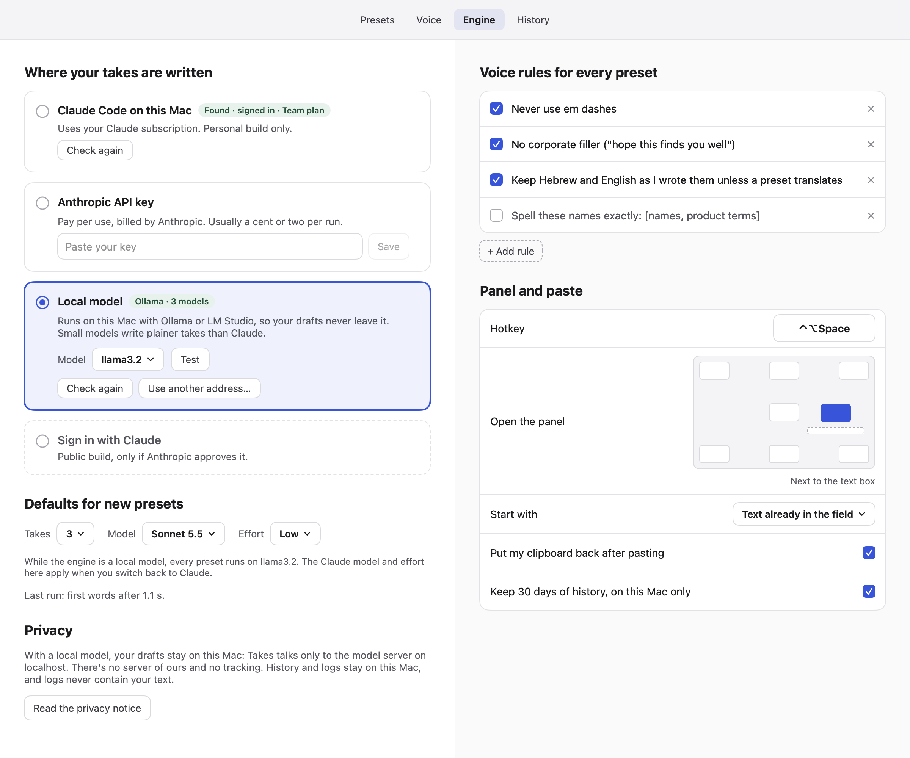 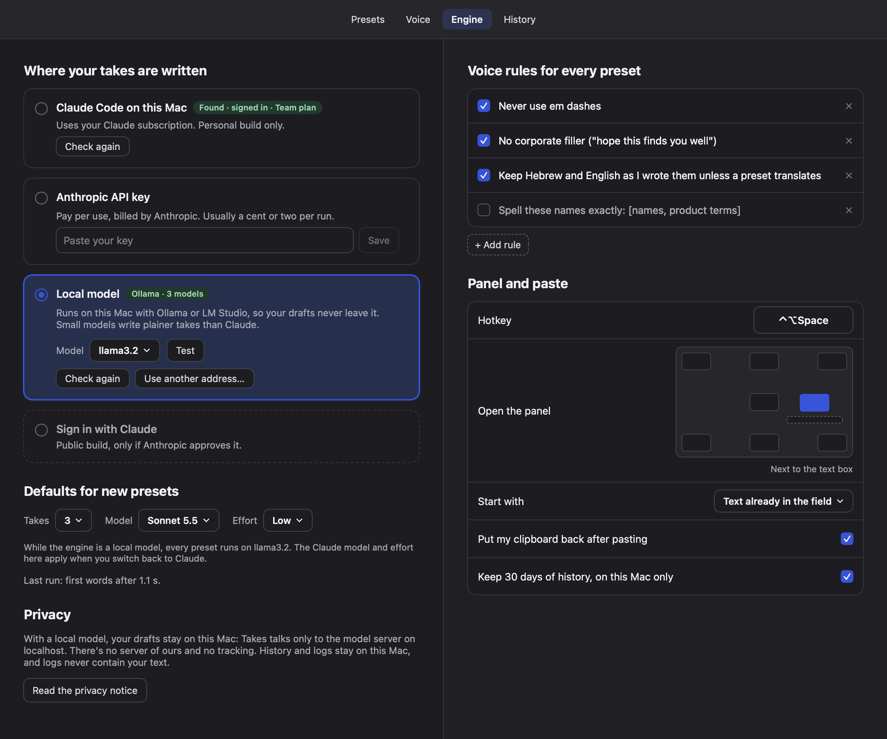
   - **Not running:** "Ollama isn't running. Open it, or install it from ollama.com. LM Studio works too: start its local
     server." The button is **Open Ollama** if the app is installed, **Copy “ollama serve”** if only the Homebrew command
     is (as on this Mac, shown below), else **Get Ollama** (opens ollama.com in the browser; nothing is downloaded).
     If the configured server is off but the other one runs, the card offers "Use LM Studio" instead.
     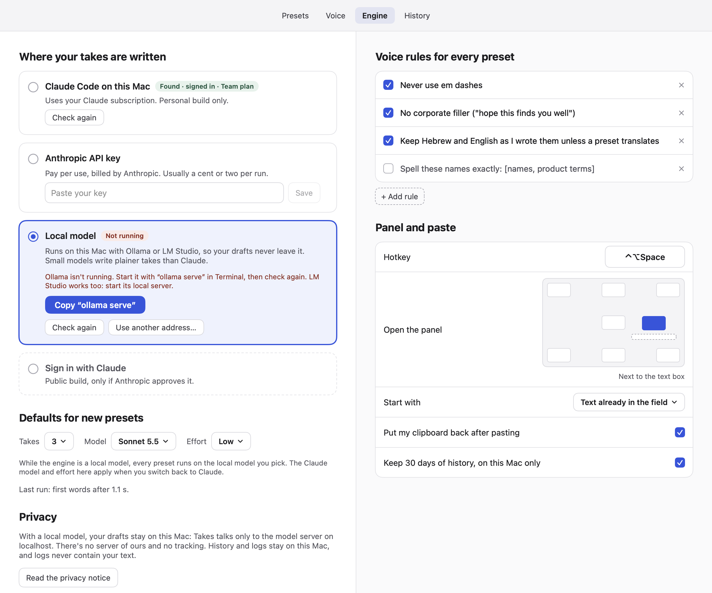 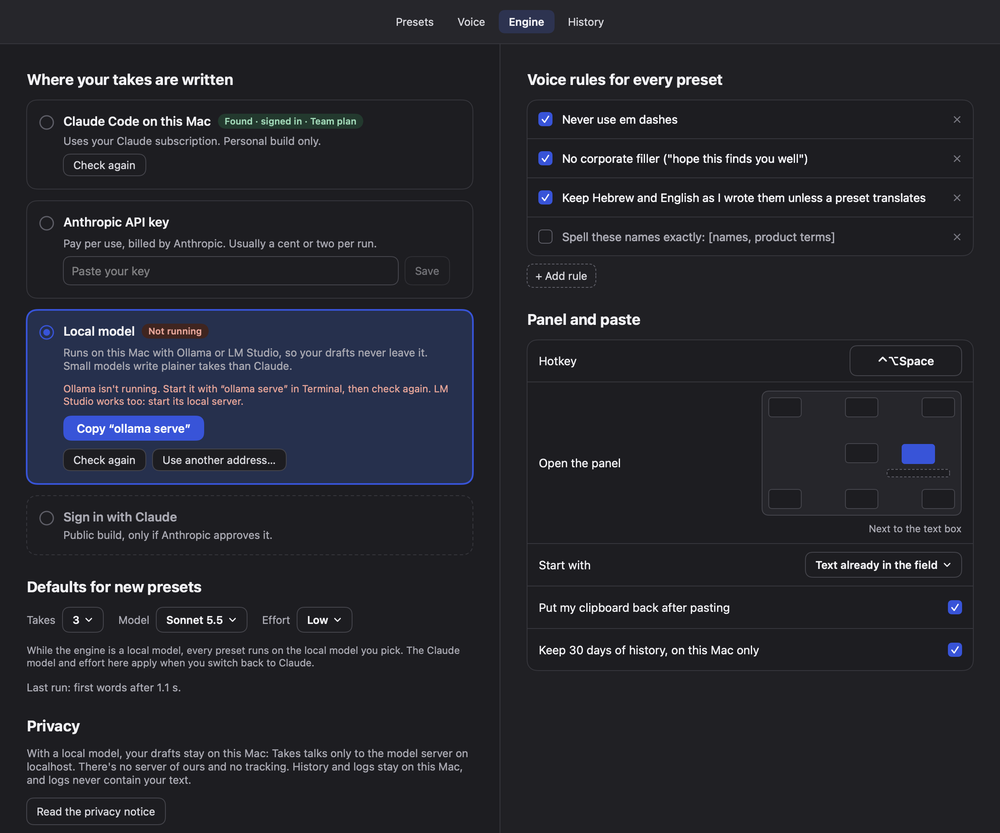
   - **Running, no models:** "Ollama is running but has no models yet. Download one in Terminal, then check again.
     llama3.2 is small (about 2 GB) and quick." with **Copy “ollama pull llama3.2”**. LM Studio gets its own wording.
     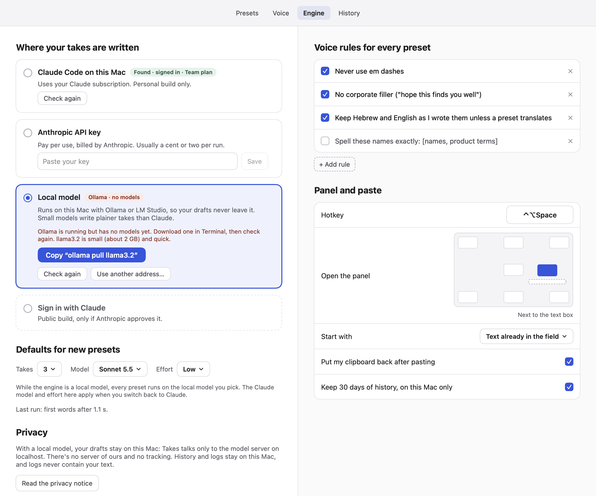 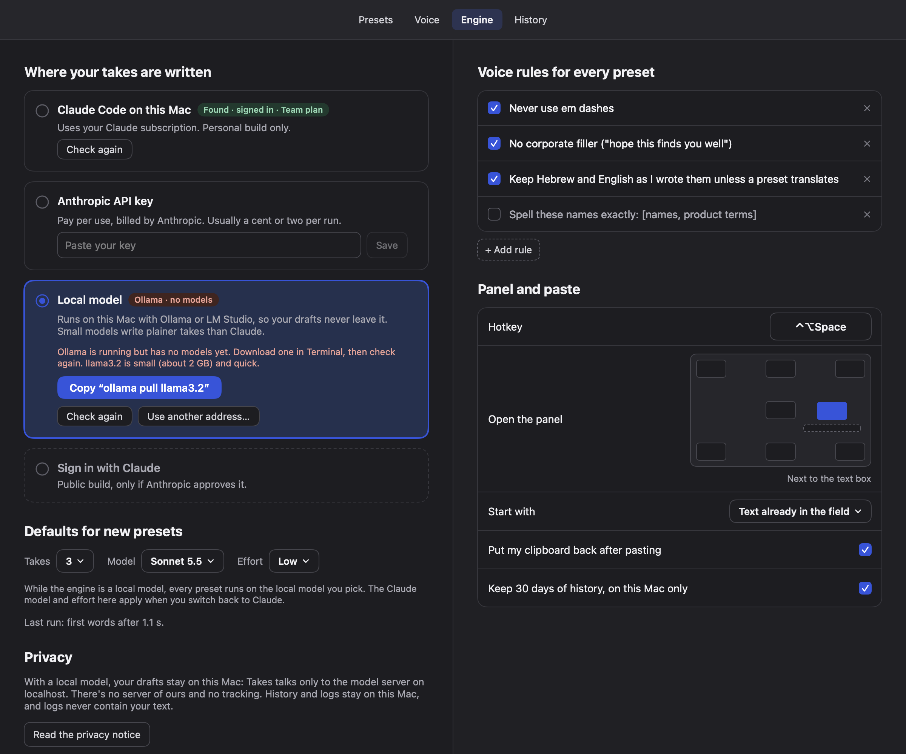
   - **Check again** and **Use another address…** (for a custom port) sit under every state. The address field accepts
     `localhost:11434`-style input and refuses anything that isn't on this Mac, inline.
   - The first installed model is picked automatically when none is set, so most people only select the card.
2. **The panel.** The Model menu lists the local models (short names, `:latest` dropped); Effort is hidden because it's a
   Claude setting. "From the preset" / "Changed for this run" compares against the local model.
   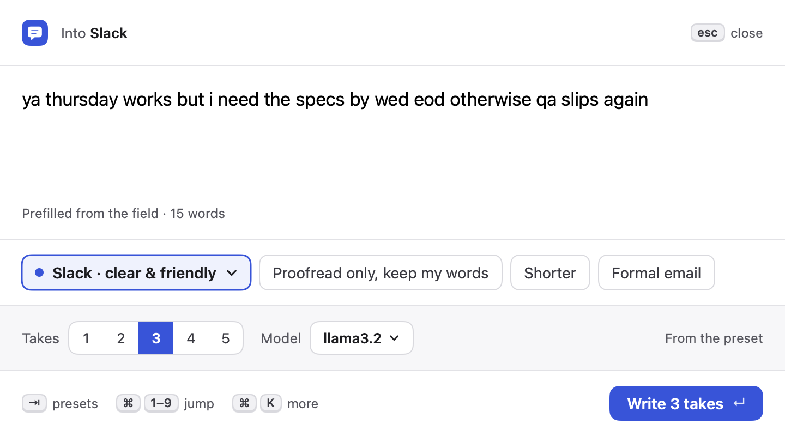 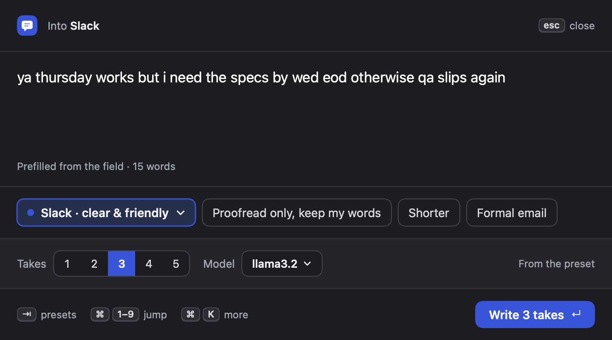
   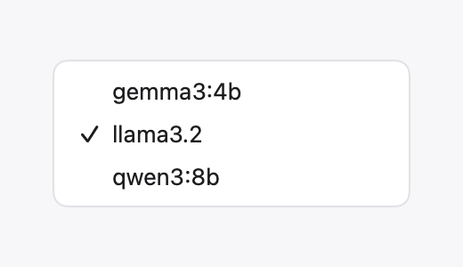 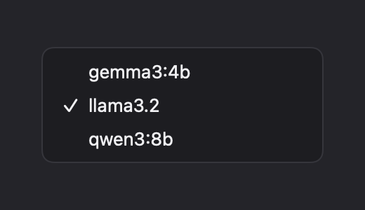
   (The real menu is a native NSMenu, which can't be drawn offscreen; the snapshot draws its items.)
3. **Preset picker and takes header** name the model that really runs: "3 takes · llama3.2 on this Mac · same or shorter".
   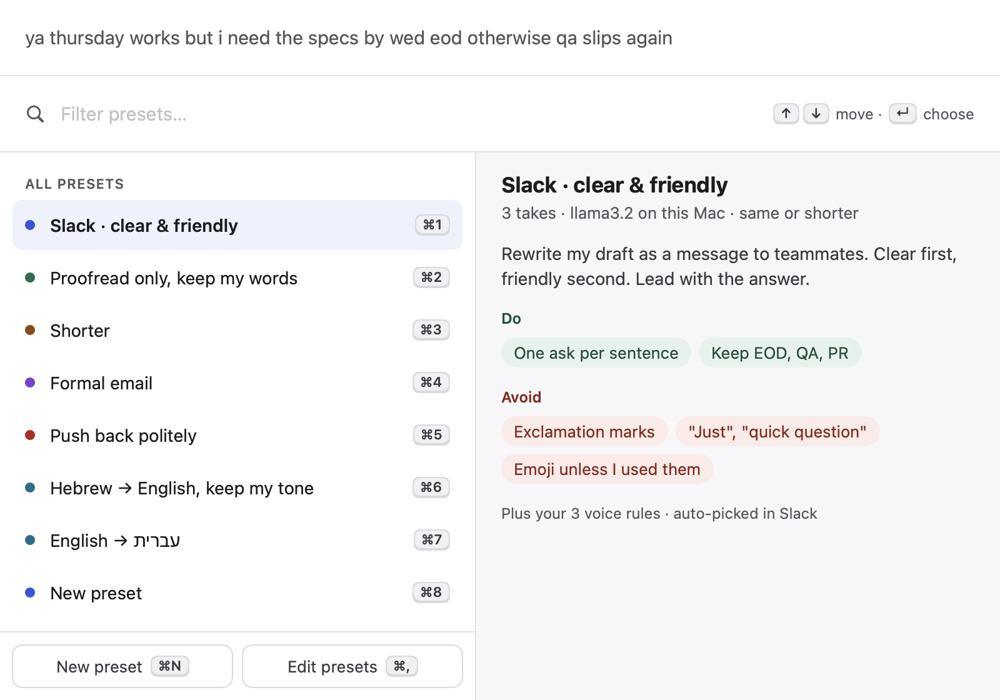 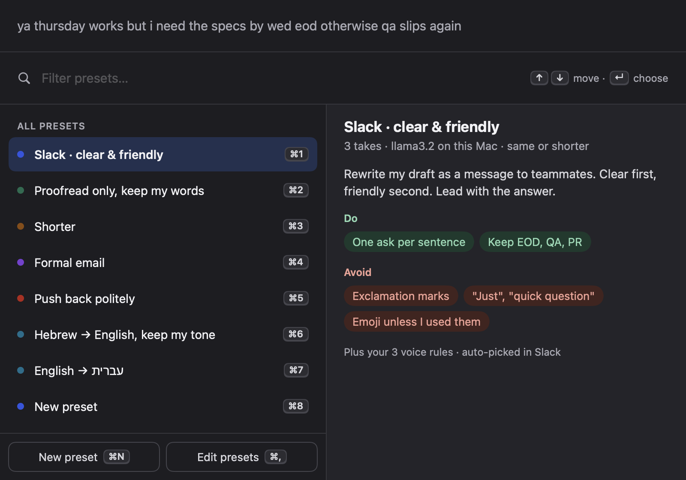
4. **Errors** say what to do: "Ollama isn't running at localhost:11434. Open it and try again, or pick another engine in
   Settings › Engine.", "Ollama doesn't have the model “qwen3”. Pick an installed model in Settings › Engine.", a timeout
   message that mentions first-run loading, and server errors passed through ("LM Studio error: out of memory").

## Per-preset model with a local engine (decision)

Presets keep their Claude model and effort; nothing is rewritten. While the engine is Local model, **every preset runs on
the one local model picked in Settings › Engine**, and the panel's Model menu switches local model for one run. Switching
back to Claude restores each preset's own model. Reasons: local model names differ per Mac and per server, so storing them
in shareable presets would break exports; most people have one or two local models; and one setting keeps the editor
simple. Where a Claude model menu is still shown (Settings › Engine defaults, preset editor "Run defaults"), a note says:
"While the engine is a local model, every preset runs on llama3.2. The Claude model and effort here apply when you switch
back to Claude."

## Prompting and parsing for small models

- `LocalEngine` appends stricter format rules to the system prompt (start right away, only `===` between versions, no
  numbering, exactly N, nothing after). `Prompt.swift` is unchanged.
- `LocalTakeCleaner` (local engine only; `TakeSplitter` for Claude is unchanged) forgives: `<think>` blocks (hidden while
  still thinking), "Here are three versions:" preambles (alone or glued to the first take), "Version 2:" / "**Take 2**" /
  "### Option 2" labels, `---` `***` `=====` and `=== Take 2 ===` separators, "1. … 2. … 3. …" when numbered exactly
  1…N at paragraph starts, wrapping quotes, code fences, a closing "Let me know…", and extra versions (cut to N).

## Security

- Only loopback hosts: `localhost`, `127.0.0.0/8`, `::1`, http(s), no userinfo (`LocalEndpoint.isLoopback`), checked on
  every request URL, not just in settings.
- Its own ephemeral `URLSession`: no proxies, no disk cache/cookies, and a redirect guard that refuses any redirect off
  loopback.

## New settings and defaults

`AppSettings` (appended at the end, `decodeIfPresent`):
- `engine` gains `.local`. Unknown engine values (a newer build's) now fall back to Claude Code instead of failing the whole
  settings decode.
- `localBaseURL` = `http://localhost:11434/v1`
- `localModel` = `""` (auto-picked on first detection)

No new shortcuts.

## Shared-file edits (small, for the merge)

- `Store.swift`: `EngineKind.local`; two settings fields; tolerant `engine` decode; **`Store.readOnly`** guard in `save`
  so `--snapshot` can show other settings without touching the user's real files (others may want it too).
- `Engine.swift`: `Engines.current` switch.
- `Setup.swift`: `refreshEngine` `case .local` → `SetupMonitor.localEngineStatus()` (ready when the server answers and has
  the picked model); the engine step's detail text and button label for local. **Onboarding:** the setup/onboarding
  privacy copy still says text goes to Anthropic; with Local model it should say it stays on the Mac. Step title "Connect
  Claude" too. Your `// ORCHESTRATOR: add local engine option` hook should offer the Local model card.
- `PanelModel.swift`: `applyPresetSettings`/`isOverridden` use `settings.runModel(for:)`; reset refreshes detection when local.
- `PanelViews.swift`: Model menu uses `model.modelOptions`, Effort hidden when local, picker summary and takes header use
  engine-aware text.
- `PresetsTab.swift`: one `LocalEngineModelNote()` line under Run defaults.
- `EngineTab.swift` (owned): the third card, section title "Where your takes are written", engine-aware privacy text,
  `EngineCard` VoiceOver fix (cards no longer collapse their buttons into one element; the radio dot is a labeled,
  actionable element).
- `Snapshot.swift`: one line calling `runLocalModels(to:)` in `Snapshot+LocalModels.swift`.
- New files: `LocalEngine.swift`, `LocalEngineViews.swift`, `Snapshot+LocalModels.swift`, `Tests/TakesTests/LocalModelsTests.swift`.

## Privacy impact

`PRIVACY.md` gains a "Local model: nothing leaves your Mac" subsection under "Where your text goes". New network activity:
only to localhost (model list probes when Settings › Engine or the panel opens with the local engine, and the runs).

## Research

- Mobbin: Descript (AI models settings: one labeled menu per choice), Cofounder (model menu inline with a short note on
  what it powers), Gumloop (models grouped by provider), Base44 (model select inside configuration). These shaped the
  "one card per engine, label + menu, short note" layout rather than a model browser.
- KB: `ai-ux/setting-expectations.md` (state limits where they bite: "Small models write plainer takes than Claude";
  name the model that runs), `ai-ux/ai-errors-and-uncertainty.md` (unavailable model: explain and offer the next step;
  keep the draft on failure, which the panel already does), `flows/first-use-and-empty-data.md` (each empty kind gets
  its own words and one primary action), `macos/settings-window.md` (instant apply; server address commits on Return
  with inline validation; detect rather than ask), `auditing/checklist-macos.md`.

## Self-audit (against the snapshots)

- FBK-04 empty states explain and offer one action: not running, no models, other server running. Pass.
- FBK-05 / INP-05 errors say what happened and what to do (engine errors, address validation, Test result). Pass.
- INP-04 address validated inline on submit, input kept. Pass.
- FBK-06 status visible: badge on the card, model named in the panel, picker and takes header. Pass.
- CLR-05 clickable things look clickable: house button styles only, no new colors/spacing. Pass.
- Light and dark checked for every state. VoiceOver: labels/hints on Test, copy buttons, address field, progress;
  engine radio dots labeled. Reduce Motion: no new animation.
- Not done: the Test result states (passed/failed) aren't in a snapshot (they're `@State`); covered by tests of
  `LocalEngine.test`.

## Tests added (`Tests/TakesTests/LocalModelsTests.swift`, 37 tests)

Loopback enforcement (allowed/refused hosts, address normalizing, engine refuses remote before sending), request
building, format rules, HTTP error wording, SSE parsing (3-byte chunks splitting lines and Hebrew characters, CRLF,
comments, `[DONE]`, last line without newline, error events), chunk parsing, model list parsing (`"data": null` from an
empty Ollama, embedding models dropped, labels), every splitter quirk above, settings decoding (old files, round trip,
unknown engine), per-preset model and summary, and an end-to-end run against a mock HTTP server on 127.0.0.1: streaming
in 17-byte chunks, stream error, missing model (404), redirect off the Mac refused, nothing running, model list and Test.
`swift test`: 84 tests pass. `./build.sh`: no warnings.

## Live check for the orchestrator

Ollama is installed on this Mac (Homebrew) and running, but has **no models**, so no live generation was run (the task
forbids downloading). To check live:
1. `ollama pull llama3.2` (about 2 GB).
2. Settings › Engine › Local model: badge "Ollama · 1 model", model auto-picked, **Test** says "Works. Answered in … s."
3. In a text field press ⌥⇧Space: the Model strip shows llama3.2 and no Effort. Write 3 takes; they stream into 3 cards
   with no preamble or labels.
4. Quit Ollama (`ollama` menu-bar icon › Quit, or stop `ollama serve`) and press Regenerate: the error says Ollama isn't
   running and the draft is kept. Check the setup window's engine step shows "Ollama isn't running".
5. Switch back to Claude Code: presets show their Claude models again.
