# 9 · provider-api: write takes with your own OpenAI, Gemini, OpenRouter, Groq or Mistral key

## What changed and why

People who already pay another provider can pick **Other provider** in Settings › Engine, paste their own API key,
pick a model, and Takes writes with it. The key lives in the macOS keychain; drafts go straight from the Mac to the
provider the user picked, under the user's account and that provider's terms. Claude Code stays the default. The
design follows `docs/plans/providers.md` (Design › Settings › Engine, The panel, Known-provider table, Legal).

## The flow

1. **Settings › Engine › Other provider.** The card says what it is ("Your own API key for OpenAI, Gemini, OpenRouter,
   Groq or Mistral, or any OpenAI-compatible server. Billed by the provider under your account.") and shows a status
   badge: "OpenAI · gpt-5.4", "No key yet", "Key refused", "Pick a model", "No address yet".
   - **No key:** a Provider menu, **Get a key** (opens the provider's key page in the browser), one line on where
     drafts go and under whose terms (before the key field), and a secure key field. Return or **Save** commits.
     The placeholder shows the key prefix ("Paste your key (sk-…)"). Pasting a key whose prefix belongs to another
     provider shows "This looks like an Anthropic key. OpenAI needs a key from its own dashboard." It still saves.
     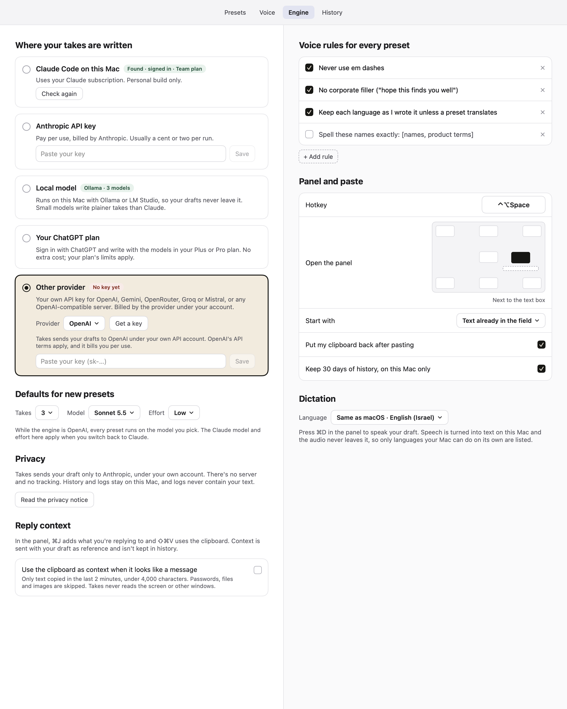 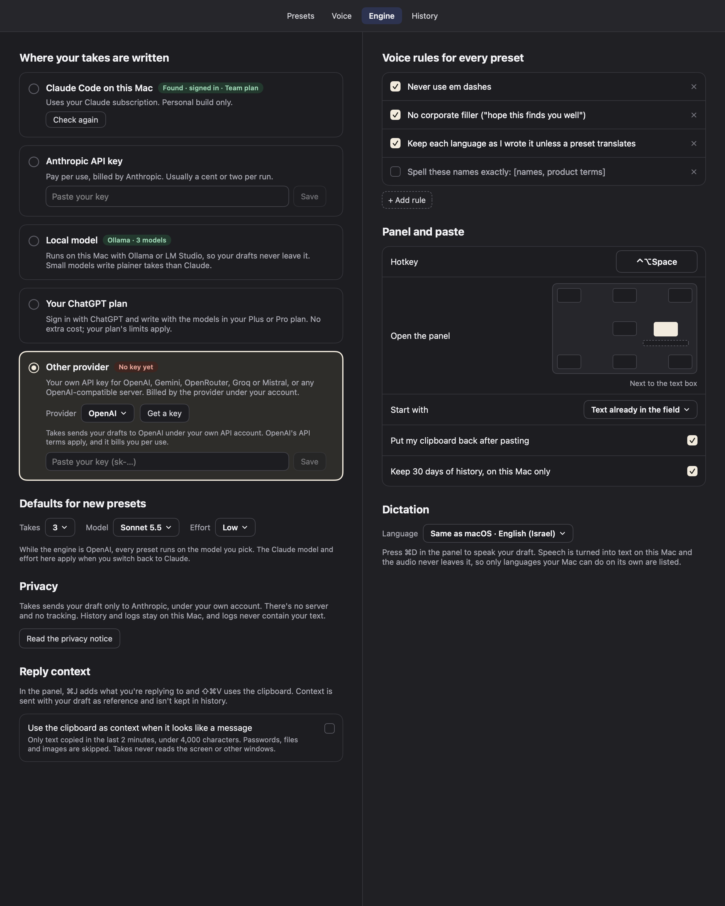
   - **Gemini** adds "Google requires a key on a project with billing on in the EEA, Switzerland and the UK."
     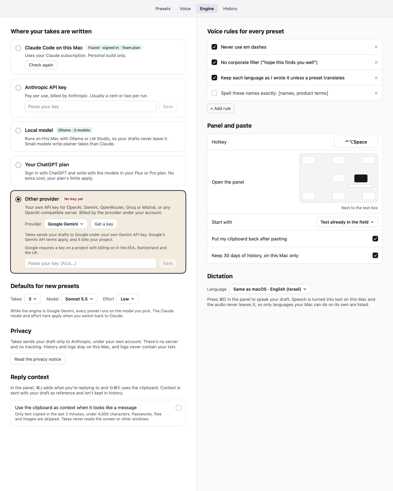 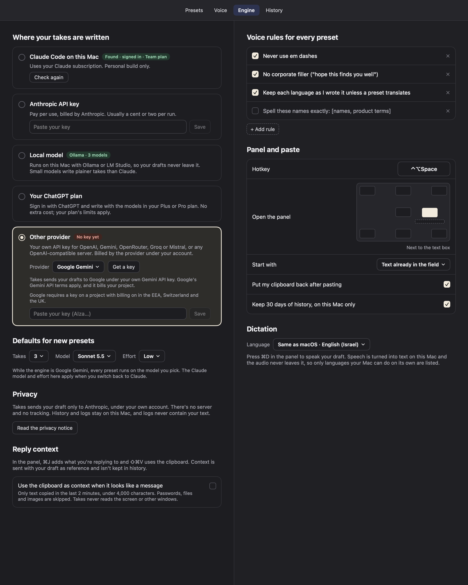
   - **Ready:** "Saved in your keychain" + **Remove**; a Model menu filled from `GET /models` (exact model IDs) and
     **Test** ("Works. Answered in 0.8 s.", or the error). With no model set, Takes picks one: the provider's
     preferred model if it's listed (see `preferredModels`), else the first.
     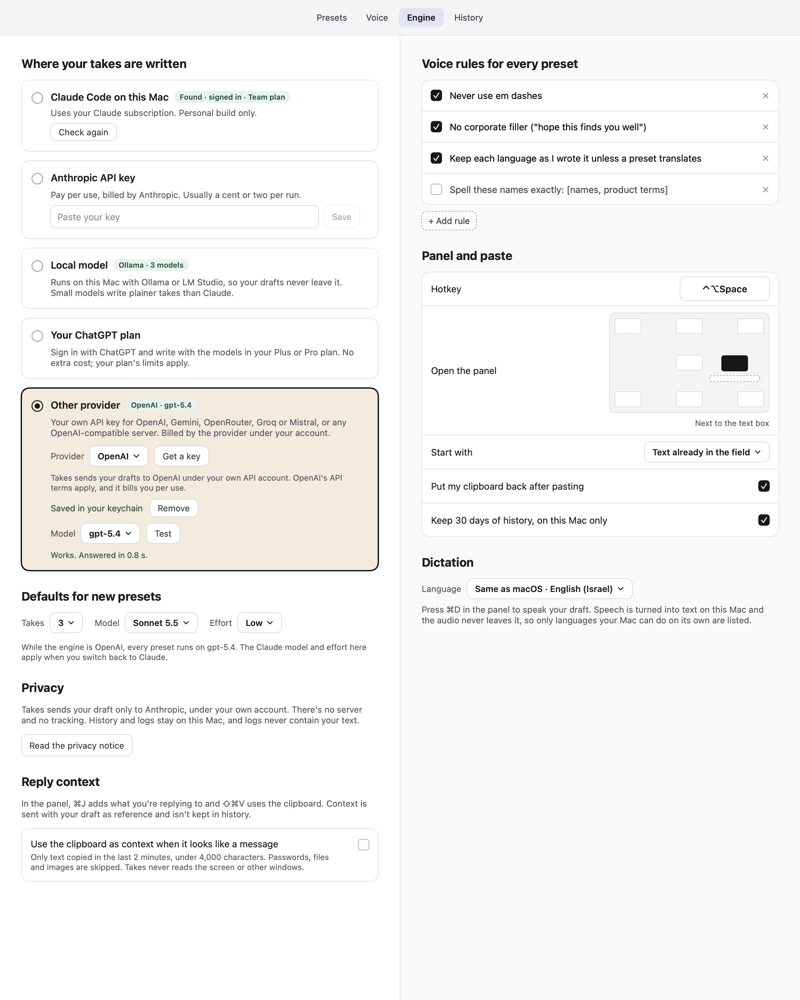 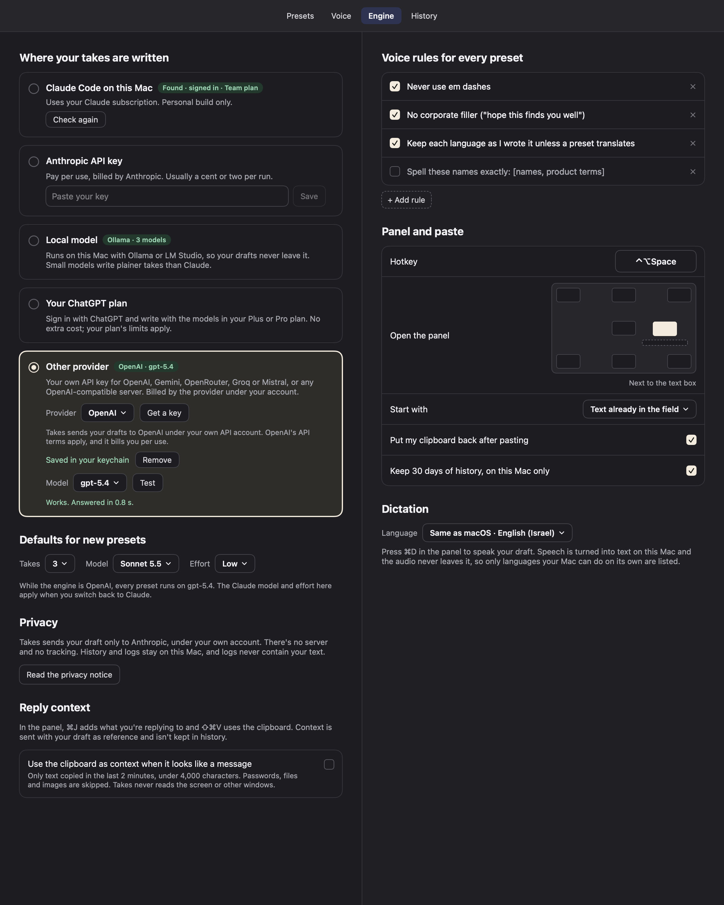
   - **Key refused:** "The key was refused. Check it in your OpenAI dashboard. Or remove it and paste a new one."
     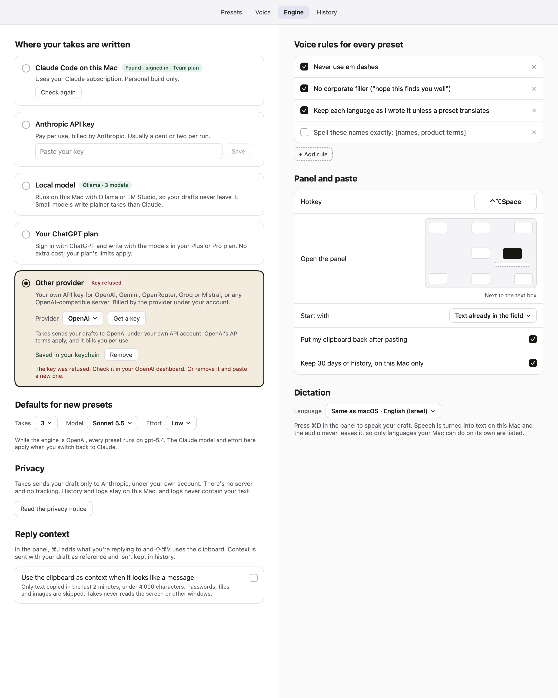 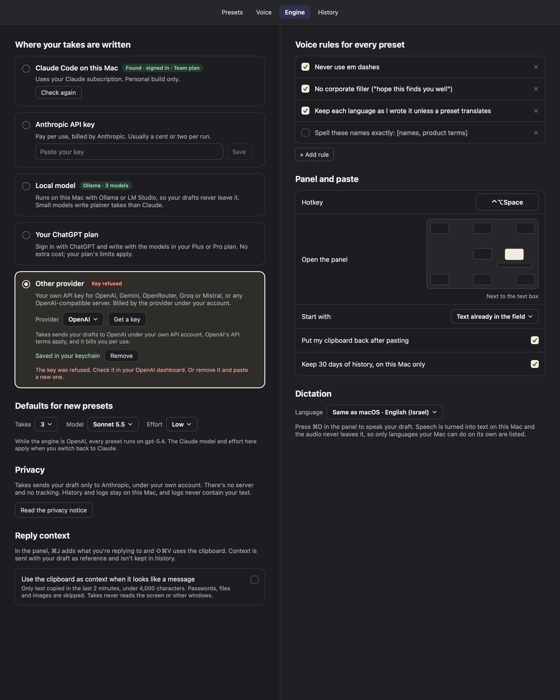
   - **Custom address:** an address field, checked when you save it ("Use an https address on the internet, such as
     https://llm.example.com/v1. Servers on this Mac go in the Local model card."), and the line "Takes sends your
     drafts to this address. Only use a server you trust." When the model list fails or is empty, a typed **Model ID**
     field with Save, Test and Check again replaces the menu (shown here with a 404 from `/models`).
     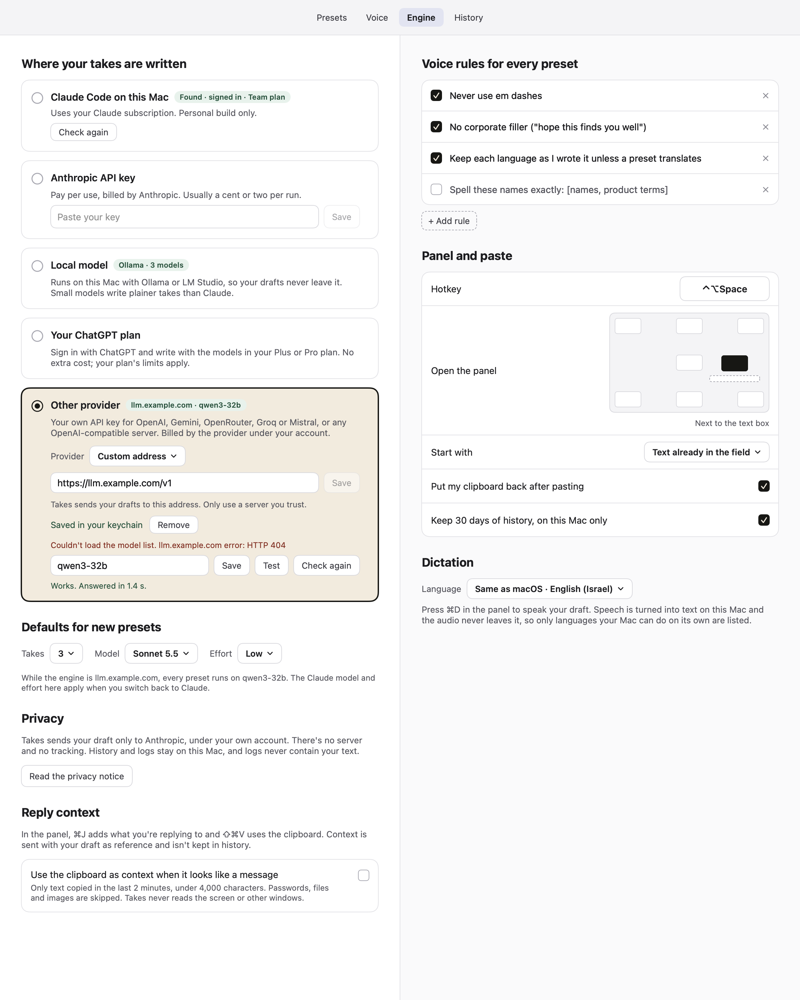 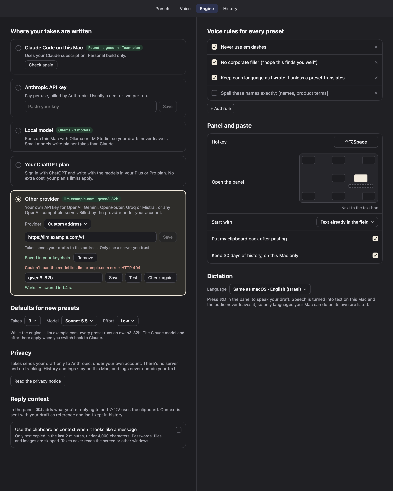
2. **Onboarding engine step** (`ProviderOnboardingDetail`): when "An OpenAI or other API key" is selected, it shows
   the Provider menu, Get a key, the key field (Return saves to the keychain) with the data note, then "Key saved.
   Takes will write with gpt-5.4-mini; change it any time in Settings › Engine." The model is picked automatically,
   so the step turns ready without opening Settings. The primary button still opens Settings › Engine, as before.
   No snapshot of this step: onboarding snapshots belong to the wording session's files.
3. **The panel.** Same as Local model: one model for every preset, the Model menu lists the provider's models for one
   run, Effort is hidden. The picker summary and takes header say "3 takes · gpt-5.4 via OpenAI · same or shorter".
   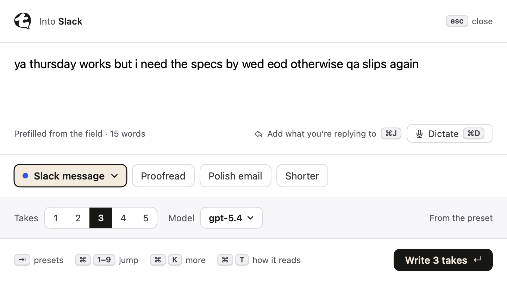 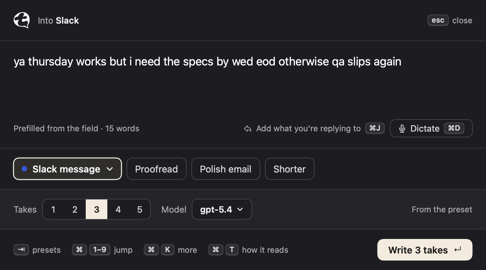
   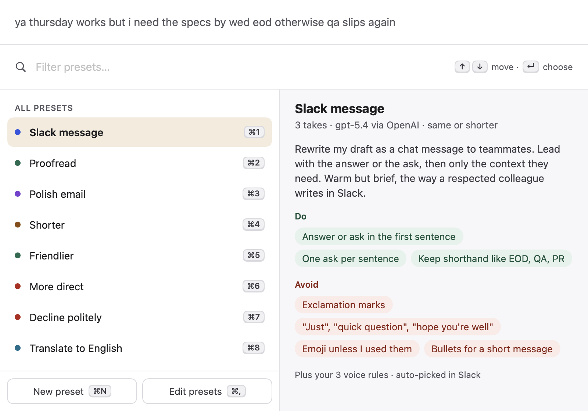 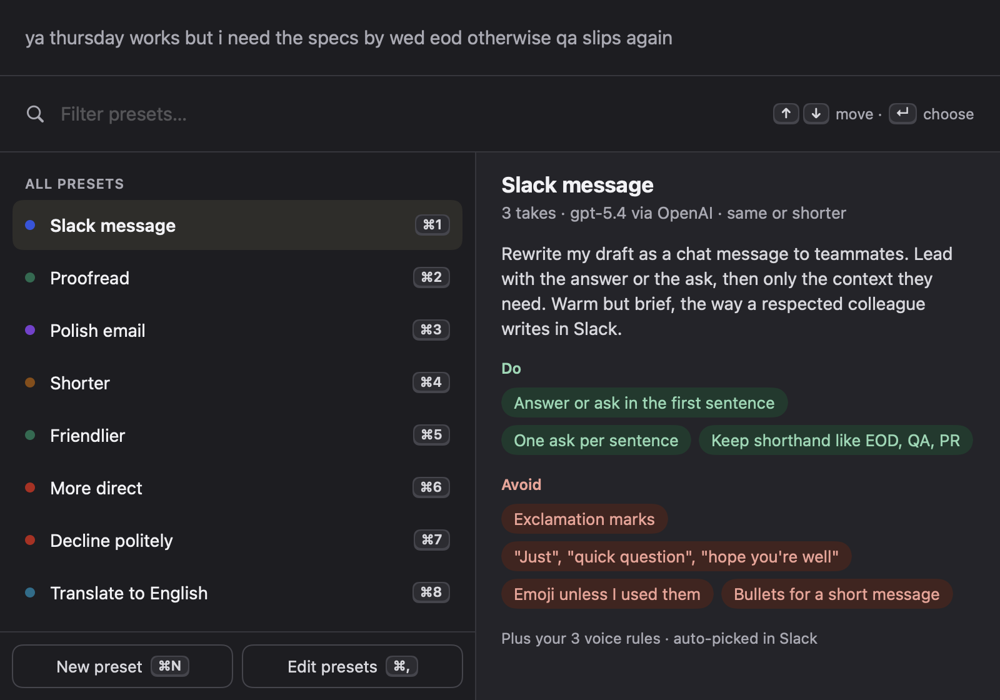
4. **Errors** say what to do: 401 (or Gemini's 400 "API key not valid") → "The key was refused. Check it in your
   <Provider> dashboard."; 429 and OpenRouter's 402 → "Over your provider's rate limit or out of credit."; missing
   model → "<Provider> doesn't have the model “x”. Pick another in Settings › Engine."; `finish_reason ==
   "content_filter"` → "The provider declined to rewrite this draft."; 5xx → "<Provider> is having trouble (HTTP 503).
   Try again in a minute."; offline, unknown host, timeout and TLS failures each get their own sentence.

## Decisions

- **Known providers** (`Provider.known`, each row cites its docs page in a comment): OpenAI, Google Gemini (OpenAI
  compatibility endpoint), OpenRouter (sends `X-Title: Takes`), Groq, Mistral; anything else is Custom. A known
  provider always uses its own base URL from code, never the stored `providerBaseURL`, so an edited settings file
  can't send an OpenAI key elsewhere.
- **Small-model format:** Groq and Custom append `LocalPrompt.formatRules` and parse with `LocalTakeCleaner`. The others
  use `TakeSplitter`, falling back to `LocalTakeCleaner` when the final result has fewer takes than asked.
- **OpenAI reasoning models** (`o1`/`o3`/`o4-*`, `gpt-5*` except `*-chat*`): sent `max_completion_tokens`, no
  `temperature`, and `reasoning_effort: "low"` (takes are short rewrites; low keeps them quick). Any provider: a 400
  naming `max_tokens`, `temperature` or `reasoning_effort` retries once per field without it (at most 3 requests).
  The plan had Effort mapping as a follow-up. This sets a fixed "low" for OpenAI reasoning models only. The panel
  still hides Effort.
- **Model list filtering:** drop embedding, audio, image, tts, whisper, dall-e, moderation, realtime, transcribe,
  legacy completions, sora, guard, ocr, codex and deep-research models; OpenAI `-pro` models (Responses-only);
  OpenRouter models whose output isn't only text; Mistral models with `completion_chat: false`; inactive Groq models.
  Gemini's `models/` prefix is stripped. Sorted by ID.
- **No logos, no "GPT" in any label**, provider names exact; the card names the engine "Other provider".
- Switching provider clears the picked model (IDs differ per provider). A new one is auto-picked from the new list.

## Security

- `ProviderEndpoint` is the inverse of `LocalEndpoint`: https only, no userinfo, no loopback (`localhost`,
  `*.localhost`, `127/8`, `::1`), no IP literals in any spelling (IPv6, dotted, `2130706433`, `0x7f.1`), no query or
  fragment in a typed address. Typed input is normalised (`https://` added, trailing `/` stripped, path defaults to
  `/v1`). Checked on every request URL, not only in settings.
- Its own ephemeral `URLSession` (no disk cookies or cache, system proxies apply), 120 s request timeout, and a
  redirect guard that only follows redirects to the same host over https.
- Keys: keychain only, one item per provider host (`provider-api.openai.com`), never in settings, `RunLog`, errors or
  snapshots (snapshots set `hasKey` by hand and never read the keychain).
- `ProviderEndpoint.allowInsecureForTests` (default false, tested) lets the mock server's `http://127.0.0.1` through
  in tests only.
- Network activity: `GET /models` when Settings › Engine opens, the panel opens with this engine, or the onboarding
  step shows; `SetupMonitor.providerEngineStatus()` (reuses a result for 60 s, so the setup timer doesn't ask the
  provider every 5 s); runs and Test. Nothing is sent without a saved key.

## New settings and defaults

None new: the scaffold already added `providerID` = `"openai"`, `providerBaseURL` = `"https://api.openai.com/v1"`,
`providerModel` = `""` (auto-picked). No new shortcuts.

## Shared-file edits

- `APIEngine.swift`: `Keychain` gains `string(account:)` / `set(_:account:)`. `apiKey` / `setAPIKey` are thin wrappers
  over account `"anthropic-api-key"`, so existing keys keep working.
- `LocalEngine.swift`, `Store.swift`: **no edits.** `ProviderEngine.chatRequest` builds on `LocalEngine.chatRequest`
  and changes its JSON body (token field, temperature, reasoning effort) instead of changing the local helper.
- Owned files: `ProviderEngine.swift` (stubs replaced; the scaffold's type names kept), `ProviderEngineViews.swift`,
  `Snapshot+Providers.swift`, `Tests/TakesTests/ProvidersTests.swift`, this note, `img/provider-api/`.

## For the orchestrator / wording session

- The Engine tab's **Privacy** paragraph (`EngineTab.swift`) still says "Takes sends your draft only to Anthropic"
  when Other provider is selected (visible in the `ready` snapshot). That text is owned by the wording session. Suggested:
  "With another provider, Takes sends your draft to <Provider name> under your own API account, and its terms apply.
  There's no server of ours and no tracking. …"
- `PRIVACY.md` needs the "Another provider's API" subsection (plan › Privacy). Data-use pages to link: OpenAI
  https://openai.com/enterprise-privacy/, Gemini https://ai.google.dev/gemini-api/terms, OpenRouter
  https://openrouter.ai/privacy, Groq https://console.groq.com/docs/your-data, Mistral https://mistral.ai/terms.
- Setup and onboarding status texts come from `providerEngineStatus()`: "No API key saved yet", "The key was refused",
  "Pick a model", "No server address yet", "Couldn't reach OpenAI", ready "OpenAI · gpt-5.4".
- `PanelModel.modelOptions` (scaffold, `LocalEngine.swift`) titles models with `LocalModelList.label`, which shows
  OpenRouter's `openai/gpt-5.4` as `gpt-5.4` in the panel menu and header. Settings shows exact IDs. That's fine for
  now; showing exact IDs in the panel too would mean changing the scaffold hook.

## Tests added (`Tests/TakesTests/ProvidersTests.swift`, 29 tests)

Endpoint validation (allowed and refused lists, normalising, test override off by default, engine refuses plain http
before sending); provider table (names, https base URLs, console links, no "GPT", flags), `current(_:)` (known
providers ignore a stored base URL), keychain accounts per host; key-prefix notes; request has the bearer header,
`X-Title`, and the right body; OpenAI reasoning-model body; retry options per 400 message; error wording for 401,
Gemini's 400, 429, 402, 404 and 400 missing model, 503, plain errors, custom refused; splitting (clean, numbered
fallback, strict format); model-list filtering for OpenAI, Gemini, OpenRouter, Mistral, Groq; auto-pick; settings
decoding (old file without the keys, round trip); `runModel` / `quickModel` / `oneModelPlace` / `summary(for:)` with
`.provider`; `Engines.current`; a real keychain set/read/replace/remove on a throwaway account. End to end against a
mock HTTP server on 127.0.0.1: streaming in 13-byte chunks with the bearer header, retry without `temperature`,
`content_filter`, refused key and missing model (run and `/models`), redirect to another host not followed, model
list + Test, nothing answering.

`swift build`: no warnings. `swift test`: 272 tests, 0 failures (3 skipped live tests, as before). `LocalModelsTests`
unchanged and green.

## Live check for the orchestrator

No live provider calls were made: no provider key was in the environment, and none was in the keychain because this
engine is new. With one real key per provider you have (short drafts, a handful of calls):
1. Settings › Engine › Other provider › OpenAI: paste the key, press Return. The badge goes to "OpenAI · <model>", the
   Model menu fills (no embedding/audio/image models), and **Test** says "Works. Answered in … s.".
2. Paste an `sk-ant-` key into OpenAI: the note appears. Remove it and paste a wrong `sk-…` key: the badge says
   "Key refused".
3. In a text field press ⌃⌥Space: Model shows the OpenAI model, no Effort; write 3 takes. Check that they stream into
   3 cards and that the header says "via OpenAI". Try one `gpt-5*` model (reasoning: the request uses
   `max_completion_tokens`) and one `gpt-4.1*` model.
4. Repeat 1 and 3 for Gemini (check the `models/` prefix is gone and runs work), OpenRouter (pick an `openai/…` and an
   `anthropic/…` model), Groq (small model; takes should come out clean with no labels) and Mistral.
5. Custom address: type `localhost:11434` → refused inline; type a real https OpenAI-compatible server → model list
   or typed ID, Test.
6. Onboarding (fresh settings): pick "An OpenAI or other API key", paste a key, press Return. The step should turn
   ready by itself with "Key saved. Takes will write with …".
7. Switch back to Claude Code: presets show their own Claude models again.
